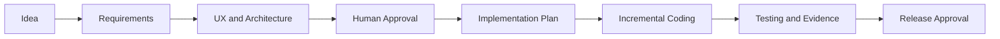
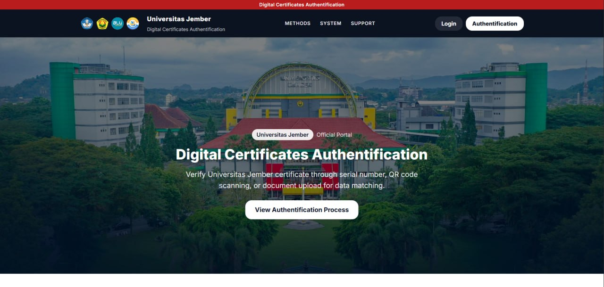
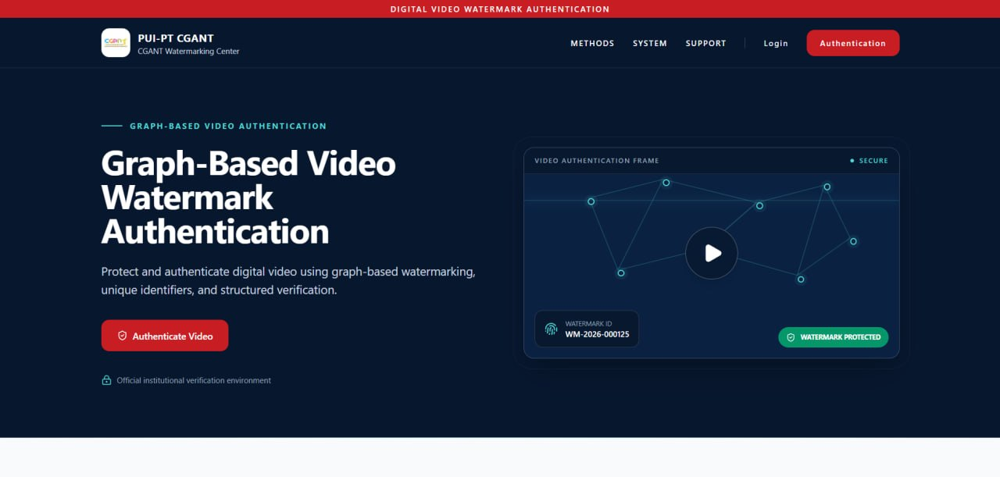

# Full-Stack Vibe Coding PRD Template

*From Ideas to Implementation-Ready Blueprints.*

A reusable, design-first Product Requirements Document framework for planning full-stack web applications with developers and AI coding agents.

This repository helps teams turn an idea into a reviewable blueprint before implementation. It combines product reasoning, UX planning, frontend and backend contracts, ASCII wireframes, Mermaid diagrams, requirements traceability, acceptance criteria, and explicit human approval gates.

> **Current status:** Documentation v0.2 prepared for private review. This repository contains planning documents—not an application, package, deployed service, or automatic security control.

> **License:** Not yet selected. The material is not offered under an open-source license until a license is explicitly added.

## Table of Contents

1. [Project Introduction](#1-project-introduction)
2. [Why This Template?](#2-why-this-template)
3. [Key Features](#3-key-features)
4. [PRD Philosophy](#4-prd-philosophy)
5. [How It Works](#5-how-it-works)
- [Built with a PRD-Driven Approach — Real-World Portfolio](#built-with-a-prd-driven-approach--real-world-portfolio)
6. [Quick Start](#6-quick-start)
7. [Project Profiles](#7-project-profiles)
8. [Repository Structure](#8-repository-structure)
9. [Master PRD Template](#9-master-prd-template)
10. [Worked Example](#10-worked-example)
11. [AI Coding Agent Workflow](#11-ai-coding-agent-workflow)
12. [Human Approval Gates](#12-human-approval-gates)
13. [Supported Technology Preferences](#13-supported-technology-preferences)
14. [Limitations](#14-limitations)
15. [Contributing](#15-contributing)
16. [Future Roadmap](#16-future-roadmap)

## 1. Project Introduction

The **Full-Stack Vibe Coding PRD Template** is a structured Markdown framework for specifying a full-stack website before implementation begins.

It is intended for:

- developers planning a new web application;
- product owners translating ideas into testable requirements;
- designers connecting user needs to routes, pages, states, and wireframes;
- teams coordinating frontend, backend, API, data, and security decisions;
- developers using AI coding agents who need an explicit operating contract.

Start with the [Master PRD Template](templates/MASTER_FULLSTACK_PRD_TEMPLATE.md), then use the [Research Task Tracker worked example](examples/RESEARCH_TASK_TRACKER_PRD.md) to see how the sections connect in practice.

## 2. Why This Template?

Fast AI-assisted coding can produce visible output before the underlying product decisions are clear. That creates predictable risks:

- features appear without a verified user need;
- routes and pages drift from API behavior;
- database fields are invented from UI controls;
- mock authentication is mistaken for production security;
- tests do not trace back to requirements;
- implementation or deployment begins without clear approval.

This template creates a deliberate path from product intent to implementation evidence. It is comprehensive when needed, but profile-based so a Small/MVP project does not have to fill every complex-system contract.

## 3. Key Features

- **Design-first development** — define the problem, experience, states, and boundaries before coding.
- **Structured PRDs** — 26 sections organized as WHY → SCOPE → WHAT → HOW → VALIDATION.
- **Frontend preference** — React JS + Vite + Tailwind CSS by default, with documented override rationale.
- **Flexible backend and database** — select project-specific services, persistence, authentication, and infrastructure.
- **ASCII wireframes** — capture page hierarchy and responsive intent in portable Markdown.
- **Mermaid diagrams** — document flows, architecture, authentication, sequences, and data relationships.
- **API and data contracts** — connect UI behavior to service and persistence boundaries.
- **Requirements traceability** — map needs to features, requirements, pages, APIs, data, acceptance criteria, and tests.
- **Testing and acceptance criteria** — use Given/When/Then for critical behavior and preserve actual evidence status.
- **Human approval gates** — separate requirements, UX, architecture, implementation, and release authority.
- **AI coding agent workflow** — define how agents should analyze, plan, implement, verify, and stop.
- **Project profiles** — scale depth for Small/MVP, Standard Full-Stack, and Complex applications.

## 4. PRD Philosophy

The template follows five layers:

```text
WHY -> SCOPE -> WHAT -> HOW -> VALIDATION
```

- **WHY** establishes the problem, users, vision, outcomes, and success criteria.
- **SCOPE** establishes boundaries, profiles, roles, risks, and unresolved decisions.
- **WHAT** defines information architecture, features, functional requirements, pages, and states.
- **HOW** defines visual direction, wireframes, diagrams, data, services, API, frontend, security, and operations.
- **VALIDATION** defines acceptance, testing, traceability, delivery phases, approval, and Definition of Done.

The document uses stable IDs such as `CF-001`, `FR-001`, `PAGE-001`, `API-001`, `DATA-001`, `AC-CF001-01`, and `TEST-CF001-01`. These IDs make cross-layer review possible without treating prose order as a contract.

## 5. How It Works



This is a recommended process, not an automatic enforcement mechanism. The people and tools using the repository must apply the approval rules deliberately.

For the complete lifecycle, see [PRD Workflow](docs/prd-workflow.md).

## Built with a PRD-Driven Approach — Real-World Portfolio

From structured requirements and interface planning to publicly accessible institutional web applications, these research-grant-supported projects illustrate how a PRD-driven development approach can guide interface design, application flows, API integration, and iterative implementation. The descriptions below are limited to contributor-confirmed context and behavior visible on the public landing pages; they do not independently validate backend algorithms, security strength, or production test coverage.

### Digital Certificates Authentication

[](https://ijazah.cgant-project.com/)

An institutional web application developed through a PUI-PT CGANT research-grant-supported initiative. Its public interface presents structured certificate verification paths using a serial or certificate number and document upload; the landing page also references QR-code scanning, watermark checks, and data matching. These statements describe the visible workflow and do not claim independent verification of the underlying authentication or security implementation.

- **Application type:** Institutional digital-certificate verification web application.
- **PRD-driven workflow highlights:** staged verification choices, explicit input and upload journeys, structured informational results, and coordinated interface/API planning.
- **Attribution:** PUI-PT CGANT, Universitas Jember.
- **Live website:** [Visit Digital Certificates Authentication](https://ijazah.cgant-project.com/)

### Graph-Based Video Watermark Authentication

[](https://video.cgant-project.com/)

A video-authentication web application developed through a PUI-PT CGANT research-grant-supported initiative. Its public interface presents Watermark ID and video-upload authentication paths plus a structured conceptual workflow from upload and analysis through validation and authentication. The interface references graph-based watermarking concepts, but this showcase does not claim independent verification of the algorithm, security properties, or authentication accuracy.

- **Application type:** Video watermark authentication web application.
- **PRD-driven workflow highlights:** alternative ID/upload journeys, an explicit multi-stage verification flow, visible system concepts, and coordinated interface/API planning.
- **Attribution:** PUI-PT CGANT, Universitas Jember.
- **Live website:** [Visit Graph-Based Video Watermark Authentication](https://video.cgant-project.com/)

These are independent real-world projects developed using a PRD-driven approach. The master template in this repository generalizes lessons from such workflows; it is not the original specification used verbatim for every project.

> **Screenshot asset notice:** Institutional logos, photographs, and branding shown in the project screenshots remain the property of their respective owners and are not covered by the repository's open-source license. The repository does not yet include an open-source license; this exclusion must remain when one is selected.

## 6. Quick Start

1. Clone or download this repository.
2. Copy `templates/MASTER_FULLSTACK_PRD_TEMPLATE.md` into your project documentation.
3. Rename the copy for your project.
4. Select a project profile and delivery level.
5. Complete WHY and SCOPE before detailed solution design.
6. Define routes, features, pages, states, and critical user flows.
7. Add only the backend, API, data, authentication, and operational contracts your project actually needs.
8. Connect requirements to acceptance criteria and proposed tests.
9. Review the PRD with human stakeholders and, if used, an AI coding agent.
10. Do not begin implementation until the implementation scope is explicitly approved.

Detailed instructions: [Getting Started](docs/getting-started.md).

No React, FastAPI, PostgreSQL, Node.js package, Python package, or other runtime dependency is required to use these Markdown documents.

## 7. Project Profiles

### Small/MVP

Use concise WHY/SCOPE sections, critical features and pages, a compact traceability matrix, and only diagrams that remove ambiguity. Mark non-applicable technical sections as `N/A — [RATIONALE]` rather than inventing infrastructure.

### Standard Full-Stack

Use complete frontend, backend, API, persistence, authentication/authorization, testing, and critical-path traceability contracts for the MVP scope.

### Complex Application

Add alternate and failure flows, multiple data scopes, integrations, async processing, lifecycle rules, recovery, capacity, compliance, operational ownership, and full bidirectional traceability.

## 8. Repository Structure

```text
.
+-- README.md
+-- CHANGELOG.md
+-- CONTRIBUTING.md
+-- .gitignore
+-- templates/
|   +-- MASTER_FULLSTACK_PRD_TEMPLATE.md
+-- examples/
|   +-- RESEARCH_TASK_TRACKER_PRD.md
+-- docs/
    +-- getting-started.md
    +-- prd-workflow.md
    +-- ai-agent-guide.md
    +-- review-notes-v0.2.md
    +-- images/
        +-- portfolio/
            +-- digital-certificates-authentication.jpg
            +-- video-watermark-authentication.jpg
```

## 9. Master PRD Template

The [Master Full-Stack PRD Template](templates/MASTER_FULLSTACK_PRD_TEMPLATE.md) is the canonical reusable document in this repository.

It includes:

- onboarding and placeholder guidance;
- stable ID registry and cross-reference rules;
- 26 main sections;
- reusable feature, page, API, data, acceptance, and test contracts;
- seven reusable ASCII wireframe patterns;
- eight Mermaid diagram patterns;
- five human approval gates;
- profile-scaled traceability and Definition of Done.

Use the master as a reference. A project instance should remain complete enough to be unambiguous, but it does not need to maximize every conditional section.

## 10. Worked Example

The [Research Task Tracker PRD](examples/RESEARCH_TASK_TRACKER_PRD.md) is a fictional Standard Full-Stack example.

It demonstrates:

- React JS, Vite, and Tailwind CSS frontend planning;
- a proposed FastAPI backend and PostgreSQL database;
- authentication and scoped authorization contracts;
- task list, task creation, detail/history, and status update flows;
- synthetic users and records using reserved `.invalid` email addresses;
- page, API, data, acceptance, and test traceability;
- unresolved decisions that remain visible instead of being guessed.

The example is **not built, not tested, and not deployed**. Its API, data model, security controls, tests, and diagrams remain proposed design artifacts.

## 11. AI Coding Agent Workflow

An AI coding agent should:

1. read the complete applicable PRD;
2. identify scope, non-goals, and unresolved decisions;
3. validate stable IDs and traceability;
4. propose UX and technical design before implementation;
5. confirm the current approval gate;
6. implement only an explicitly approved increment;
7. run actual quality checks and report their real output;
8. stop before migration, release, or production actions without separate approval.

Reusable prompts and operating rules are provided in the [AI Agent Guide](docs/ai-agent-guide.md).

## 12. Human Approval Gates

- **GATE-01 — Requirements and Scope:** authorizes detailed UX and architecture planning.
- **GATE-02 — UX/Design:** approves IA, routes, pages, states, wireframes, and flows.
- **GATE-03 — Architecture/API/Data/Security:** approves technical and trust-boundary contracts.
- **GATE-04 — Implementation Authorization:** authorizes only the stated coding increment.
- **GATE-05 — Production/Release Approval:** authorizes only the exact release or deployment action stated.

`GATE-02` and `GATE-03` may iterate in either order, but both must cover compatible versions before `GATE-04`.

A Markdown gate is a recommended operating contract—not an automated security boundary. Human users and agents remain responsible for enforcing it.

## 13. Supported Technology Preferences

Default frontend preference:

- React JS functional components;
- Vite;
- Tailwind CSS;
- React Router when routing is needed;
- Lucide React when icons improve comprehension.

Conditional recommendations:

- TanStack Query for server-state coordination;
- React Hook Form for complex forms;
- Zod for client-side schema validation.

Backend, database, authentication, hosting, and deployment are intentionally project-specific. FastAPI and PostgreSQL are used only in the worked example and are not mandatory defaults.

## 14. Limitations

- This repository provides documentation and planning contracts, not executable enforcement.
- The template is intentionally comprehensive and should be scaled using a project profile.
- Mermaid blocks were structurally validated for v0.2, but actual renderer validation was not executed because no approved renderer was available during preparation.
- The worked example contains proposed and not-run tests; it does not provide implementation evidence.
- Project-specific accessibility, security, privacy, performance, deployment, and compliance decisions still require qualified human review.
- A repository license has not yet been selected. The material is not yet legally presented as open-source.

See [v0.2 Review Notes](docs/review-notes-v0.2.md) for validation scope and remaining limitations.

## 15. Contributing

Contributions are welcome for private review after the project owner enables the relevant collaboration workflow. Useful contributions include:

- clearer PRD sections and instructions;
- additional synthetic examples;
- diagram corrections;
- improved AI-agent operating prompts;
- accessibility, security, and traceability improvements;
- documentation fixes.

Read [CONTRIBUTING.md](CONTRIBUTING.md) before proposing a change. Do not include secrets, real participant data, private URLs, production configuration, or third-party material without confirmed redistribution rights.

## 16. Future Roadmap

Potential future work, subject to review and approval:

- select and add a repository license;
- add a dependency-free documentation validator;
- validate Mermaid diagrams with an approved renderer;
- add more synthetic project profiles and worked examples;
- refine contribution and versioning policy;
- prepare a separately approved public release.

Private repository preparation does not authorize public visibility. A later publication review must explicitly approve the license, final documentation, and visibility change.
