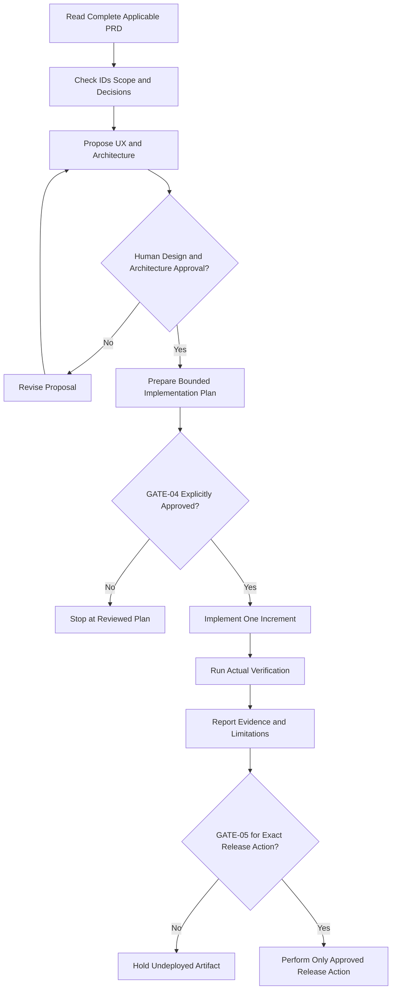

# AI Coding Agent Guide

This guide describes a recommended operating contract for using a Product Requirements Document (PRD) with AI coding agents.

The rules in a Markdown file are not an automatic sandbox or security control. Human users and agents must actively enforce scope, approval, credential, data, and production boundaries.

## Core Operating Principles

An AI coding agent should:

1. **Read the PRD first.** Do not infer the product from a single feature request.
2. **Identify unresolved requirements.** Report `TBD`, `DECISION REQUIRED`, open risks, and conflicting contracts.
3. **Validate scope and traceability.** Confirm that requested work maps to approved features and requirements.
4. **Propose design before implementation.** Reconcile routes, states, UI, API, data, security, and tests.
5. **Never assume coding approval.** Receipt of a PRD, `GATE-01`, `GATE-02`, or `GATE-03` is not `GATE-04`.
6. **Implement incrementally.** Work within one bounded, explicitly authorized increment.
7. **Verify with actual tests.** Run the approved checks and report real outputs.
8. **Never claim unperformed tests passed.** Use `NOT RUN`, `BLOCKED`, or `NOT VERIFIED` honestly.
9. **Require separate production approval.** Implementation authorization does not authorize migration, release, deployment, or production mutation.
10. **Stop safely.** Ask for a human decision when scope, security, data, migration, or production authority is unclear.

## Recommended Agent Intake Checklist

Before proposing implementation, the agent should report:

- selected project profile and delivery level;
- current PRD status and approved version;
- relevant `NEED-*`, `GOAL-*`, `CF-*`, and `FR-*` records;
- affected pages, routes, APIs, data models, NFRs, and security controls;
- linked acceptance criteria and proposed tests;
- open `DEC-*`, risks, constraints, and dependencies;
- current human approval gate;
- requested file and dependency scope;
- explicit non-goals and stop conditions.

If the information is absent, the agent should propose documentation corrections or ask for a decision—not silently invent a contract.

## Approval-Aware Workflow



## Reusable Example Prompts

Replace bracketed fields with your project facts. Attach or link the applicable PRD and do not include credentials.

### A. PRD Understanding Prompt

```text
Read the complete PRD before proposing implementation.

Return:
1. the selected project profile and delivery level;
2. the problem, users, goals, scope, and non-goals;
3. the active core features and functional requirements;
4. the relevant pages, routes, APIs, data entities, NFRs, and security controls;
5. all unresolved placeholders, DECISION REQUIRED items, contradictions, and risks;
6. the current approval gate;
7. a concise traceability summary for the requested area.

Do not write code. Do not infer approval. Distinguish verified facts from proposals and unknowns.
```

### B. Requirements and Architecture Review Prompt

```text
Review this PRD for cross-layer consistency without modifying source files.

Check:
- user need -> goal -> feature -> FR/BR;
- feature -> page/route -> API -> data;
- authentication, authorization, and data-scope boundaries;
- NFR/security requirements and verification methods;
- AC -> FR and TEST -> AC relationships;
- unresolved or conflicting decisions;
- design-first, MVP, and production claim boundaries.

Report findings by severity with exact IDs and section references. Treat missing evidence as unknown, not as permission to invent a solution. Do not implement anything.
```

### C. UI/UX Planning Prompt

```text
Using only the approved requirements and scope in this PRD, propose the UX/design plan for [FEATURE_IDS].

Include:
- information architecture and route impact;
- page and component responsibilities;
- loading, empty, success, validation, permission, and network/server states;
- responsive and accessibility behavior;
- ASCII wireframes for the approved pages;
- Mermaid user/feature flows where they remove ambiguity;
- cross-references to FLOW, CF, PAGE, ROUTE, WF, AC, and DEC records.

Do not create new features, APIs, database fields, branding, or deployment assumptions. Mark unresolved choices as DECISION REQUIRED. Stop at a reviewable design proposal; do not code.
```

### D. Implementation Planning Prompt

```text
Prepare a bounded implementation plan for the approved scope [CF/FR IDS].

First verify that GATE-02 and GATE-03 cover compatible versions. Then provide:
- exact scope and exclusions;
- affected files/components;
- API/data/security contracts that must remain invariant;
- dependency changes, if any, with rationale;
- ordered implementation increments;
- proposed tests mapped to AC/TEST IDs;
- verification commands;
- migration, rollback, and production boundaries;
- stop conditions.

Do not modify files or install dependencies. This plan is for GATE-04 review and is not itself implementation authorization.
```

### E. Approved Incremental Coding Prompt

```text
GATE-04 is approved only for this increment:
[EXACT APPROVED CF/FR IDS, FILE SCOPE, DEPENDENCIES, AND EXCLUSIONS]

Implement the smallest complete increment that satisfies the approved contracts.

Requirements:
- inspect the current repository and verify the approved baseline first;
- do not change unrelated files or requirements;
- preserve API/data/security and non-goal boundaries;
- add or update tests mapped to [AC/TEST IDS];
- run the approved verification commands;
- report actual output, failures, and unverified areas;
- do not claim unrun tests passed;
- do not create migrations, release, deploy, restart services, or modify production unless separately and explicitly authorized.

Stop when the increment and its evidence are complete.
```

## Review Prompts versus Action Prompts

A review prompt should explicitly say **do not modify files**. An action prompt should define:

- approved IDs;
- exact file scope;
- dependency policy;
- required verification;
- prohibited operations;
- stop condition.

Avoid vague instructions such as “build the app from this PRD.” They hide decisions about scope, authorization, dependencies, data, and deployment.

## Evidence Rules

Agents should distinguish:

- **PROPOSED:** a design or test that has not been executed;
- **NOT RUN:** an executable check that was not performed;
- **BLOCKED:** a check or task prevented by a named dependency or decision;
- **FAIL:** an executed check that did not meet its pass condition;
- **PASS:** an executed check with retained evidence;
- **NOT VERIFIED:** an aspect the available tooling or authority could not inspect.

A traceability row is not test evidence. A code diff is not deployment evidence. A local build is not production-readiness evidence.

## Security and Privacy Boundaries

Never place the following in a prompt or PRD example:

- API keys, tokens, passwords, private keys, or session values;
- private environment files;
- production database strings;
- participant or customer records;
- internal-only URLs or private operational paths;
- unrestricted logs containing personal or secret data.

Use clearly synthetic values and reserved domains such as `example.invalid`.

## Human Responsibility

Human reviewers remain responsible for:

- deciding product scope;
- approving UX and technical architecture;
- authorizing implementation;
- approving destructive or production actions;
- evaluating legal, security, privacy, accessibility, and compliance needs;
- determining whether test evidence is sufficient.

An agent may prepare an approval record but must not approve a gate on behalf of a human.

## Related Documents

- [Master Template](../templates/MASTER_FULLSTACK_PRD_TEMPLATE.md)
- [Getting Started](getting-started.md)
- [PRD Workflow](prd-workflow.md)
- [Worked Example](../examples/RESEARCH_TASK_TRACKER_PRD.md)
