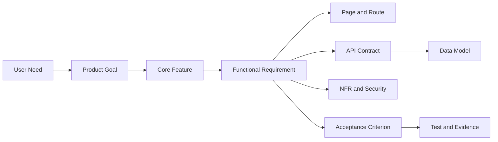
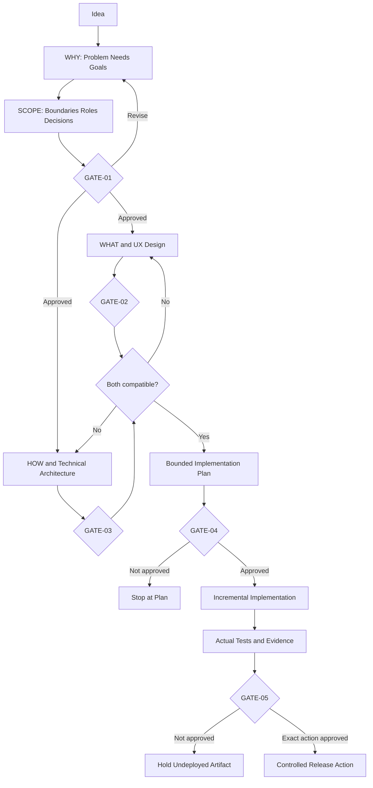

# PRD Workflow

The template organizes product development into five connected layers:

```text
WHY -> SCOPE -> WHAT -> HOW -> VALIDATION
```

This document explains how those layers connect, how stable IDs create traceability, and where human approval gates apply.

## 1. WHY

WHY defines the product intent:

- overview and current phase;
- problem statement and evidence status;
- vision and value proposition;
- user needs, outcomes, and success metrics.

Typical IDs:

- `PRINCIPLE-*`
- `NEED-*`
- `GOAL-*`
- `METRIC-*`

The goal is to distinguish a verified problem from a proposed solution. Unsupported claims remain `TBD`.

## 2. SCOPE

SCOPE defines what the project will and will not do:

- goals, in-scope items, and non-goals;
- project profile and delivery level;
- users, roles, permissions, and data scope;
- assumptions, constraints, dependencies, risks, and decisions.

Typical IDs:

- `SCOPE-*`
- `NON-GOAL-*`
- `ROLE-*`
- `ASM-*`, `CON-*`, `DEP-*`, `RISK-*`, `DEC-*`

A visible non-goal is as important as a feature because it prevents scope from expanding silently.

## 3. WHAT

WHAT defines the behavior and user-facing structure:

- information architecture;
- routes and user journeys;
- core features;
- functional and business requirements;
- non-functional requirements;
- pages and UI states.

Typical IDs:

- `FLOW-*`
- `CF-*`
- `FR-*`
- `BR-*`
- `NFR-*`
- `PAGE-*`
- `ROUTE-*`
- `STATE-*`

Features should remain outcome-oriented. Functional requirements should be atomic and verifiable.

## 4. HOW

HOW defines the approved design and technical contracts:

- visual direction and component system;
- ASCII wireframes;
- Mermaid flows and architecture;
- domain, state, and data model;
- backend/service responsibilities;
- APIs and integrations;
- frontend/component architecture;
- authentication, security, and privacy;
- environments, deployment, and operations;
- AI-assisted workflow and approval gates.

Typical IDs:

- `WF-*`
- `COMP-*`
- `DATA-*`
- `SVC-*`
- `API-*`
- `INT-*`
- `SEC-*`

A diagram is an explanatory view. Its accompanying metadata links it to canonical requirements; the diagram does not silently redefine those requirements.

## 5. VALIDATION

VALIDATION defines how the proposed system will be accepted:

- testing strategy and quality gates;
- Given/When/Then acceptance criteria;
- proposed test scenarios;
- traceability matrix;
- implementation phases;
- Definition of Done and handover.

Typical IDs:

- `AC-CFNNN-NN`
- `TEST-CFNNN-NN`
- `TRACE-EX-*`
- `GATE-*`

A test remains `PROPOSED` or `NOT RUN` until an implementation exists and actual evidence has been produced.

## End-to-End Traceability



A legitimate client-only or backend-only feature may not use every layer. Record `N/A — [RATIONALE]` or a reviewed `TRACE-EX-*` instead of creating fake contracts.

## Worked Traceability Example

The [Research Task Tracker](../examples/RESEARCH_TASK_TRACKER_PRD.md) includes this critical path:

```text
NEED-002 — Create a task
  -> GOAL-002 — Consistent task capture and status updates
  -> CF-003 — Create Research Task
  -> FR-005 / FR-006 — Atomic valid creation and invalid-input rejection
  -> PAGE-003 / ROUTE-003 — Create Task page
  -> API-005 — POST /api/tasks
  -> DATA-002 / DATA-003 — Task and initial status event
  -> NFR-REL-001 / SEC-004 / SEC-005
  -> AC-CF003-01 / AC-CF003-02
  -> TEST-CF003-01 / TEST-CF003-02
```

The example does not claim those tests passed. They are proposed verification contracts for a future authorized implementation.

## Approval Gates

### GATE-01 — Requirements and Scope

Reviews:

- problem and evidence;
- users and needs;
- goals, scope, and non-goals;
- selected project profile;
- critical risks and decisions;
- initial traceability.

Authorizes detailed UX and architecture planning only.

### GATE-02 — UX/Design

Reviews:

- information architecture;
- routes and user journeys;
- pages and UI states;
- wireframes and design direction;
- responsive and accessibility behavior.

Creates an approved UX baseline. It does not authorize coding by itself.

### GATE-03 — Architecture/API/Data/Security

Reviews:

- frontend and backend boundaries;
- API and integration contracts;
- data entities and lifecycle;
- authentication and authorization;
- security, privacy, operations, and risks.

Creates an approved technical baseline. It does not authorize coding by itself.

### GATE-04 — Implementation Authorization

Requires compatible `GATE-02` and `GATE-03` versions plus a bounded implementation plan.

Authorizes only the stated coding increment. It does not automatically authorize dependency changes, migration, release, deployment, or production mutation unless those actions are explicitly included and otherwise approved.

### GATE-05 — Production/Release Approval

Reviews the exact release artifact and target-specific evidence, including applicable migration, rollback, operations, security, and known limitations.

Authorizes only the exact release or deployment action recorded by an authorized human.

## Workflow Diagram



UX and architecture may iterate. If one materially changes the other, update affected records and re-review the relevant gate.

## Change Control

A material change to scope, data classification, authorization, API, persistence, or architecture should:

1. update the canonical record;
2. update affected cross-references;
3. identify impacted acceptance criteria and tests;
4. invalidate downstream approval when necessary;
5. receive human review before dependent implementation continues.

## Status Vocabulary

Use explicit states:

- `DRAFT`
- `PENDING`
- `DECISION REQUIRED`
- `PROPOSED`
- `NOT RUN`
- `BLOCKED`
- `PASS`
- `FAIL`
- `NOT VERIFIED`

Do not use `PASS` for a test, build, render, release, or deployment unless the relevant action was actually executed and evidence exists.

## Related Documents

- [Master Template](../templates/MASTER_FULLSTACK_PRD_TEMPLATE.md)
- [Getting Started](getting-started.md)
- [AI Agent Guide](ai-agent-guide.md)
- [Worked Example](../examples/RESEARCH_TASK_TRACKER_PRD.md)
