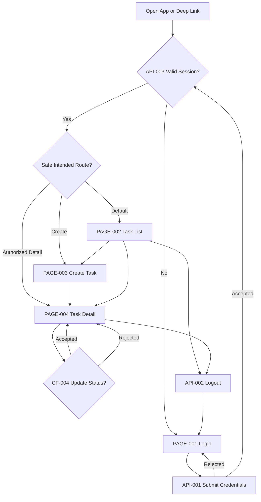
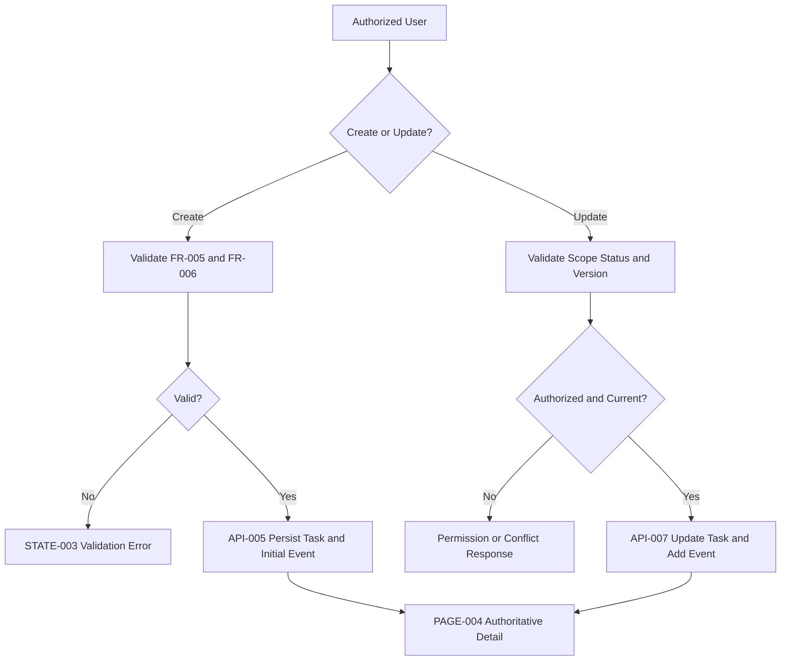
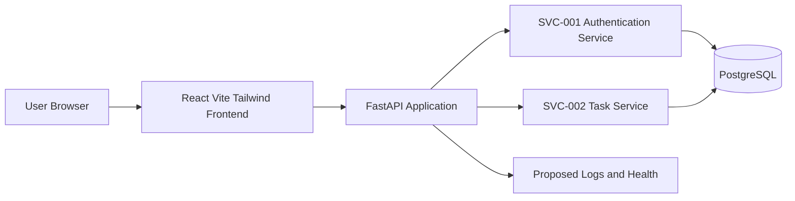
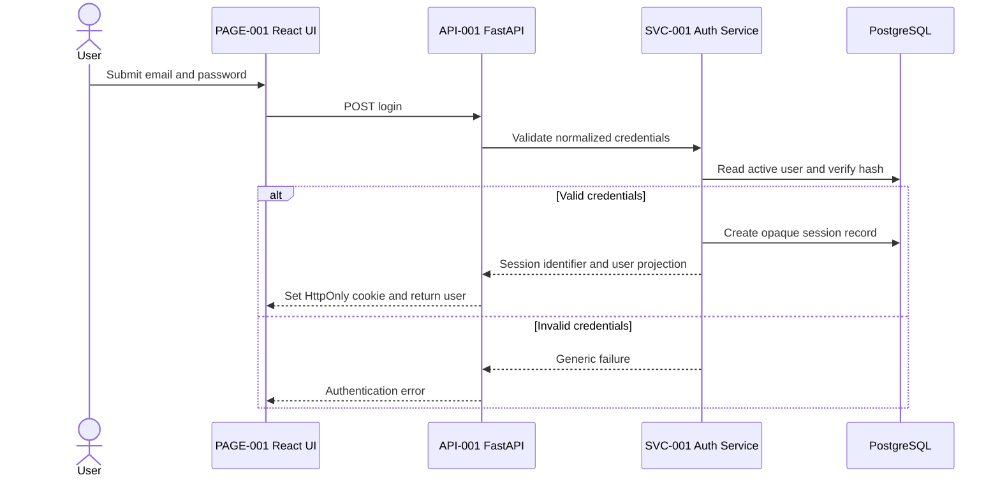
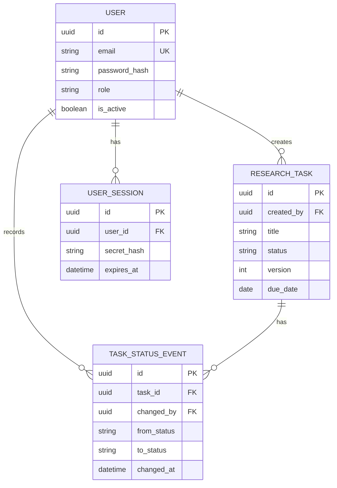

# Research Task Tracker — Full-Stack Web Application PRD

> **Status:** DRAFT v0.2 — Worked Example — Awaiting User Review<br>
> **Purpose:** Demonstrate practical use of `MASTER_FULLSTACK_PRD_TEMPLATE_V0.2.md`<br>
> **Project profile:** Standard Full-Stack<br>
> **Delivery level:** Design-first PRD for a proposed MVP<br>
> **Implementation status:** NOT BUILT, NOT TESTED, NOT DEPLOYED<br>
> **Data:** All users, identifiers, and task records below are synthetic

---

## How to Read This Example

This worked example follows all 26 main sections of the master template while keeping the project intentionally small. It demonstrates the traceability chain:

```text
User Need
  -> Core Feature
  -> Functional Requirement
  -> Page/Route
  -> API
  -> Data Model
  -> Acceptance Criterion
  -> Proposed Test
```

All architecture, routes, APIs, data models, diagrams, and tests are **PROPOSED**. No implementation or execution is claimed. Approval gates remain `PENDING`.

## Document Control

| Field | Value |
|---|---|
| Project name | Research Task Tracker |
| Product description | A proposed authenticated web application for recording and tracking research tasks |
| PRD version | 0.2 worked example |
| Status | DRAFT — Awaiting User Review |
| Project profile | Standard Full-Stack |
| Current delivery level | Design-first PRD for proposed MVP |
| Product owner | Synthetic Product Owner |
| Technical owner | TBD |
| Design owner | TBD |
| Security/data owner | TBD |
| Created date | TBD |
| Repository | N/A — no repository exists for this example |
| Deployment target | DECISION REQUIRED |

### Proposed technology decisions

| Concern | Proposed choice | Example-specific rationale |
|---|---|---|
| Frontend | React JS + Vite + Tailwind CSS | Matches the master default and supports a small responsive dashboard |
| Routing | React Router | Four authenticated/public routes require client-side routing |
| Icons | Lucide React | Conditional; useful for task/status/navigation icons |
| Data fetching | TanStack Query, recommended | Conditional recommendation for API cache and mutation invalidation |
| Forms | React Hook Form + Zod, recommended | Conditional recommendation for create-task validation |
| Backend | FastAPI | Explicitly selected for this worked example only |
| Database | PostgreSQL | Relational constraints and auditable task status events |
| Authentication | Opaque server-side session with an HttpOnly cookie | Demonstrates authentication and backend authorization |
| Infrastructure | DECISION REQUIRED | The example does not select or claim a deployment target |

### Synthetic sample records

| Record | Synthetic value |
|---|---|
| Researcher user | `Researcher Alpha`, `researcher.alpha@example.invalid` |
| Coordinator user | `Coordinator Beta`, `coordinator.beta@example.invalid` |
| Task | `Draft literature review outline` |
| Task ID | `11111111-1111-4111-8111-111111111111` |

No password, credential, token, or real personal data is included.

---

## I. WHY

### 1. Overview

Research Task Tracker is a proposed authenticated full-stack web application for a small research team. It provides one place to view tasks, create tasks, inspect details, and update task status.

The MVP has four user-facing pages and a small FastAPI/PostgreSQL backend. It is not a project-management suite and does not claim implementation, testing, or deployment.

### 2. Problem Statement

Research tasks may be distributed across personal notes, chat messages, and spreadsheets. A researcher can lose visibility into current work, while a coordinator may not know which tasks are pending, blocked, or complete.

The proposed product addresses three specific problems:

1. no single task list with consistent status values;
2. inconsistent task capture and ownership;
3. no simple auditable record of status changes.

Evidence status: this is a fictional demonstration problem. It is not supported by real interviews or production analytics.

### 3. Product Vision & Value Proposition

> Give a small research team a clear, secure, and low-friction view of current work without introducing the complexity of a large project-management platform.

| Principle ID | Principle | Practical implication |
|---|---|---|
| `PRINCIPLE-001` | Clarity before complexity | The MVP uses a list, form, and detail page rather than configurable boards |
| `PRINCIPLE-002` | Explicit ownership | Every task has one creator/owner |
| `PRINCIPLE-003` | Auditable status | Every accepted status change creates a status event |
| `PRINCIPLE-004` | Honest system state | Loading, empty, permission, validation, and server errors are explicit |

### 4. User Needs, Outcomes & Success Metrics

#### User needs

| Need ID | Role | Need statement | Priority |
|---|---|---|---|
| `NEED-001` | `ROLE-001`, `ROLE-002` | View accessible research tasks and their current status | MUST |
| `NEED-002` | `ROLE-001`, `ROLE-002` | Create a task with clear ownership and validation | MUST |
| `NEED-003` | `ROLE-001`, `ROLE-002` | Update an authorized task's status and see the result | MUST |
| `NEED-004` | `ROLE-001`, `ROLE-002` | Access task data only after authentication and within role scope | MUST |

#### Goals and proposed validation metrics

| Goal ID | Goal | Related needs | Proposed metric/review method |
|---|---|---|---|
| `GOAL-001` | Provide a single task list for accessible work | `NEED-001` | Critical list journey passes acceptance review |
| `GOAL-002` | Make task capture and status update consistent | `NEED-002`, `NEED-003` | Create and update acceptance scenarios pass when implemented |
| `GOAL-003` | Enforce authenticated, scoped access | `NEED-004` | Unauthorized and cross-scope scenarios are rejected |

#### Proposed metric/review registry

| Metric ID | Goal | Proposed measure | Owner/window | Status |
|---|---|---|---|---|
| `METRIC-001` | `GOAL-001` | Critical list/detail journey meets all linked ACs | Product owner / each candidate release | PROPOSED |
| `METRIC-002` | `GOAL-002` | Create and status-update critical ACs pass without orphan status events | Product plus technical owner / each candidate release | PROPOSED |
| `METRIC-003` | `GOAL-003` | All negative authentication and cross-owner authorization tests pass | Security/data owner / each candidate release | PROPOSED |

Numeric adoption baselines remain `TBD`; this example has no real usage data.

---

## II. SCOPE

### 5. Goals, Scope, Non-Goals & Release Boundaries

#### In scope

| Scope ID | Item | Goal | MVP |
|---|---|---|---:|
| `SCOPE-001` | Sign in and sign out | `GOAL-003` | Yes |
| `SCOPE-002` | View accessible tasks | `GOAL-001` | Yes |
| `SCOPE-003` | Create a research task | `GOAL-002` | Yes |
| `SCOPE-004` | View task details and status history | `GOAL-001`, `GOAL-002` | Yes |
| `SCOPE-005` | Update task status | `GOAL-002` | Yes |

#### Non-goals

| Non-goal ID | Exclusion | Rationale |
|---|---|---|
| `NON-GOAL-001` | Kanban drag-and-drop board | Not required to demonstrate the critical workflow |
| `NON-GOAL-002` | File attachments | Adds storage and upload-security scope |
| `NON-GOAL-003` | Email/chat notifications | External integrations are unnecessary for the example |
| `NON-GOAL-004` | Multi-tenant organizations | The example uses one synthetic research workspace |
| `NON-GOAL-005` | Automated AI task generation | Not required for task tracking |
| `NON-GOAL-006` | Production deployment | Requires a later target-specific decision and approval |

#### Delivery boundaries

| Capability | Design-first | MVP target | Production target |
|---|---:|---:|---:|
| Page/route/API/data contracts | Yes | Yes | Yes |
| Real authentication | Proposed only | Required | Required and hardened |
| PostgreSQL persistence | Proposed only | Required | Required with operations plan |
| Deployment | No | No | DECISION REQUIRED |

### 6. Project Classification & Delivery Level

**Profile:** Standard Full-Stack.

Rationale:

- React frontend and FastAPI backend;
- persistent PostgreSQL data;
- authentication and role-aware authorization;
- no external integration or async worker;
- small number of roles, entities, routes, and features.

| Conditional area | Decision |
|---|---|
| Backend/API/data | Active |
| Authentication/RBAC | Active |
| Async queue/worker | N/A — all MVP operations are synchronous |
| File upload | N/A — excluded by `NON-GOAL-002` |
| External integrations | N/A — excluded by `NON-GOAL-003` |
| Deployment topology | DECISION REQUIRED |

### 7. Target Users, Roles & Permissions

#### Roles

| Role ID | Role | Needs | Data scope |
|---|---|---|---|
| `ROLE-001` | Researcher | `NEED-001`, `NEED-002`, `NEED-003`, `NEED-004` | Tasks created by that researcher |
| `ROLE-002` | Research Coordinator | `NEED-001`, `NEED-002`, `NEED-003`, `NEED-004` | All tasks in the single synthetic workspace |

#### Permission matrix

| Resource/action | `ROLE-001` Researcher | `ROLE-002` Coordinator |
|---|---:|---:|
| View task list | Own tasks | All tasks |
| View task detail/history | Own tasks | All tasks |
| Create task | Allowed; self becomes owner | Allowed; self becomes owner |
| Update task status | Own tasks | All tasks |
| Delete task | Denied in MVP | Denied in MVP |
| Manage users/roles | Denied | Denied in MVP |

Backend authorization is canonical. A hidden button is not a security control.

### 8. Assumptions, Constraints, Dependencies, Risks & Open Decisions

| ID | Type | Item/options | Owner | Blocks | Status/mitigation |
|---|---|---|---|---|---|
| `ASM-001` | Assumption | One synthetic research workspace is sufficient for the example | Product owner | None for example | Open but accepted for demonstration |
| `CON-001` | Constraint | Documentation-only; no application may be built in this phase | Product owner | Implementation | Active |
| `DEP-001` | Dependency | A later implementation would require approved Python/Node/PostgreSQL environments | Technical owner | `GATE-04` implementation plan | Not authorized now |
| `RISK-001` | Risk | Overbroad query could expose another researcher's task | Security/data owner | `GATE-03` | Enforce owner scope in `SVC-002` and negative integration tests |
| `RISK-002` | Risk | Concurrent updates could overwrite a newer status | Technical owner | `GATE-03` | Use integer `version` and reject stale updates |
| `DEC-001` | Decision | Deployment target: managed platform / VPS / other | Production owner TBD | Production planning and `GATE-05`, not MVP architecture approval | DECISION REQUIRED |
| `DEC-002` | Decision | Session expiry and idle timeout values | Security/data owner | `GATE-03` | DECISION REQUIRED |
| `DEC-003` | Decision | Status-event retention duration | Security/data owner | Production readiness and `GATE-05`, not design-first review | DECISION REQUIRED |
| `DEC-004` | Decision | Cross-owner resource response: `403` versus safe `404` | Security/data owner | `GATE-03` and related AC/test finalization | DECISION REQUIRED |

---

## III. WHAT

### 9. Information Architecture, Routes & User Journeys

#### Information architecture

```text
Research Task Tracker
|
+-- Public
|   +-- Login (/login)
|
+-- Authenticated
    +-- Task List (/tasks)
    +-- Create Task (/tasks/new)
    +-- Task Detail (/tasks/:taskId)
```

#### Route registry

| Route ID | Path | Page | Access | Features |
|---|---|---|---|---|
| `ROUTE-001` | `/login` | `PAGE-001` | Public; redirect authenticated users | `CF-001` |
| `ROUTE-002` | `/tasks` | `PAGE-002` | `ROLE-001`, `ROLE-002` | `CF-002` |
| `ROUTE-003` | `/tasks/new` | `PAGE-003` | `ROLE-001`, `ROLE-002` | `CF-003` |
| `ROUTE-004` | `/tasks/:taskId` | `PAGE-004` | Authorized task scope | `CF-002`, `CF-004` |

#### Journey registry

| Flow ID | Journey | Entry | Success destination | Recovery |
|---|---|---|---|---|
| `FLOW-001` | Authenticate | `ROUTE-001` | `ROUTE-002` | Stay on login with generic error |
| `FLOW-002` | View tasks | `ROUTE-002` | Task list or empty state | Retry or re-authenticate |
| `FLOW-003` | Create task | `ROUTE-003` | `ROUTE-004` for created task | Correct validation or retry |
| `FLOW-004` | Update status | `ROUTE-004` | Updated detail/history | Correct conflict/permission/error |

#### Navigation and route-guard rules

- An unauthenticated request to `ROUTE-002`, `ROUTE-003`, `ROUTE-004` redirects to `ROUTE-001` and preserves only a safe intended-route value.
- `API-003` is the canonical session bootstrap check; `API-001` is used only to create a session.
- An authenticated user visiting `ROUTE-001` is redirected to `ROUTE-002`.
- Browser refresh/deep link on an authorized detail route reloads session first, then task detail.
- Back from `ROUTE-003` returns to `ROUTE-002`; cancel does not persist data.
- Unknown routes show a safe not-found page with a link to `ROUTE-002` or `ROUTE-001` according to session state.
- Cross-owner task routes follow `DEC-004` and never disclose task content.
- Logout calls `API-002`, clears client user state, and navigates to `ROUTE-001`.

### 10. Core Features & Functional Requirements

#### Feature catalog

| Feature ID | Name | Primary role | Need | Priority |
|---|---|---|---|---|
| `CF-001` | Authenticate User | `ROLE-001`, `ROLE-002` | `NEED-004` | MUST |
| `CF-002` | View Research Tasks | `ROLE-001`, `ROLE-002` | `NEED-001` | MUST |
| `CF-003` | Create Research Task | `ROLE-001`, `ROLE-002` | `NEED-002` | MUST |
| `CF-004` | Update Task Status | `ROLE-001`, `ROLE-002` | `NEED-003` | MUST |

#### CF-001 — Authenticate User

| Field | Contract |
|---|---|
| Trigger | Submit login form on `PAGE-001` |
| Preconditions | User is not authenticated |
| Input | Email and password |
| Output | Opaque session cookie and current-user response |
| Business rules | `BR-001`, `BR-002` |
| Page/route | `PAGE-001` / `ROUTE-001` |
| APIs/data | `API-001`, `API-002`, `API-003`; `DATA-001`, `DATA-004` |
| Security | `SEC-001`, `SEC-002`, `SEC-003` |
| Acceptance | `AC-CF001-01`, `AC-CF001-02`, `AC-CF001-03`, `AC-CF001-04` |

#### CF-002 — View Research Tasks

| Field | Contract |
|---|---|
| Trigger | Open `ROUTE-002` or `ROUTE-004` |
| Preconditions | Authenticated session |
| Output | Authorized task list/detail and status history |
| Business rules | `BR-003`, `BR-004` |
| States | Loading, empty, success, permission denied, server error |
| Pages/routes | `PAGE-002` / `ROUTE-002`; `PAGE-004` / `ROUTE-004` |
| APIs/data | `API-004`, `API-006`; `DATA-001`, `DATA-002`, `DATA-003` |
| Acceptance | `AC-CF002-01`, `AC-CF002-02`, `AC-CF002-03`, `AC-CF002-04` |

#### CF-003 — Create Research Task

| Field | Contract |
|---|---|
| Trigger | Submit form on `PAGE-003` |
| Preconditions | Authenticated `ROLE-001` or `ROLE-002` |
| Input | Title, description, optional due date |
| Output | Created task with `TODO` status and version `1` |
| Business rules | `BR-003`, `BR-005`, `BR-006` |
| Pages/routes | `PAGE-003` / `ROUTE-003` |
| APIs/data | `API-005`; `DATA-002`, `DATA-003` |
| Acceptance | `AC-CF003-01`, `AC-CF003-02` |

#### CF-004 — Update Task Status

| Field | Contract |
|---|---|
| Trigger | Submit status action on `PAGE-004` |
| Preconditions | Authenticated and authorized for task; current version known |
| Input | New status and expected version |
| Output | Updated task/version and new status event |
| Business rules | `BR-003`, `BR-004`, `BR-007`, `BR-008` |
| Pages/routes | `PAGE-004` / `ROUTE-004` |
| APIs/data | `API-007`; `DATA-002`, `DATA-003` |
| Acceptance | `AC-CF004-01`, `AC-CF004-02`, `AC-CF004-03` |

#### Functional requirements

| FR ID | Feature | Requirement |
|---|---|---|
| `FR-001` | `CF-001` | The system MUST authenticate a valid active synthetic user and create an opaque server-side session. |
| `FR-002` | `CF-001` | The system MUST reject invalid credentials using a generic message. |
| `FR-003` | `CF-002` | The system MUST list only tasks authorized for the authenticated role and owner scope. |
| `FR-004` | `CF-002` | The system MUST return an explicit empty state when no authorized tasks exist. |
| `FR-005` | `CF-003` | The system MUST atomically create a valid task owned by the authenticated creator plus its initial `null -> TODO` status event. |
| `FR-006` | `CF-003` | The system MUST reject invalid task input without persisting a task or status event. |
| `FR-007` | `CF-004` | The system MUST update status only for an authorized task, a valid different target status, and the current version. |
| `FR-008` | `CF-004` | The system MUST atomically create exactly one status event for each accepted status change. |
| `FR-009` | `CF-004` | The system MUST reject a stale expected version with a conflict response and no mutation. |
| `FR-010` | `CF-001` | The system MUST revoke the current session on logout and clear the session cookie. |
| `FR-011` | `CF-001` | The system MUST return the current safe user projection for a valid session and reject an absent, expired, or revoked session. |
| `FR-012` | `CF-002` | The system MUST return an authorized task detail with status history ordered from newest to oldest. |
| `FR-013` | `CF-002` | The system MUST reject cross-owner task detail access according to the approved `DEC-004` policy without leaking task content. |
| `FR-014` | `CF-004` | The system MUST reject a cross-owner status update according to `DEC-004` and create no task or event mutation. |

#### Business rules

| BR ID | Rule |
|---|---|
| `BR-001` | Login uses normalized email matching and never exposes whether an account exists. |
| `BR-002` | Inactive users cannot create a session. |
| `BR-003` | Task status is one of `TODO`, `IN_PROGRESS`, `BLOCKED`, or `DONE`. |
| `BR-004` | Researchers access only their own tasks; coordinators access all tasks in the single workspace. |
| `BR-005` | Task title is trimmed and must contain 3–120 characters. |
| `BR-006` | Description is optional with a proposed maximum of 2,000 characters; due date is optional ISO date. |
| `BR-007` | Status updates require the current integer version; accepted updates increment version by one. |
| `BR-008` | Any transition between two different values in `TODO`, `IN_PROGRESS`, `BLOCKED`, and `DONE` is allowed for an authorized user; a same-status request is rejected with conflict and creates no version/event change. |
| `BR-009` | Task status history is returned newest first; ties use immutable event ID ordering. |

### 11. Non-Functional Requirements

| NFR ID | Category | Proposed requirement | Verification if implemented |
|---|---|---|---|
| `NFR-PERF-001` | Performance | Task list API p95 target ≤ 1.5 seconds for the agreed MVP dataset | Controlled API performance test |
| `NFR-SEC-001` | Security | All task APIs require authenticated backend authorization | Integration/security tests |
| `NFR-A11Y-001` | Accessibility | Critical pages target WCAG 2.2 AA | Automated and manual review |
| `NFR-RESP-001` | Responsive | Critical flows remain usable at 320px width and desktop | Viewport review |
| `NFR-REL-001` | Reliability | Accepted create/status operations are transactionally persisted | Integration tests |
| `NFR-MAINT-001` | Maintainability | UI, state, and API services remain separated | Architecture/code review |
| `NFR-PRIV-001` | Privacy | API/log projections omit credentials and minimize personal data | Contract plus log review |
| `NFR-OBS-001` | Observability | Proposed request IDs, safe errors, health, and auth/API failure metrics | Operational review before production |

Additional category decisions:

- Scalability/capacity: `TBD — define expected users/tasks before GATE-05`.
- Localization/timezone: `N/A — [RATIONALE: English-only synthetic example; timestamps use UTC in API and localized display is future scope]`.
- SEO: `N/A — [RATIONALE: authenticated application; login page is not a public content product]`.
- Cost: `TBD — blocked by DEC-001 deployment target`.

The performance threshold is a proposed requirement, not a measured result.

### 12. Page/Route Specifications & UI States

#### Page registry

| Page ID | Page | Route | Primary features | Wireframe |
|---|---|---|---|---|
| `PAGE-001` | Login | `ROUTE-001` | `CF-001` | `WF-001` |
| `PAGE-002` | Task List | `ROUTE-002` | `CF-002` | `WF-002` |
| `PAGE-003` | Create Task | `ROUTE-003` | `CF-003` | `WF-003` |
| `PAGE-004` | Task Detail | `ROUTE-004` | `CF-002`, `CF-004` | `WF-004` |

#### Key page contracts

| Page | Required regions/actions | Required states |
|---|---|---|
| `PAGE-001` | Email, password, sign-in action, generic auth error | Idle, submitting, invalid, server error |
| `PAGE-002` | Header, task rows/cards, create action, logout | Loading, empty, success, error, session expired |
| `PAGE-003` | Title, description, due date, cancel, create | Idle, validation error, submitting, success, error |
| `PAGE-004` | Title, owner, status, description, due date, status history, status action | Loading, success, permission denied, conflict, error |

#### Page behavior details

| Page | Actor/access | Entry and exit | Responsive/accessibility | Acceptance |
|---|---|---|---|---|
| `PAGE-001` | Public; authenticated user redirects away | App entry; success to `ROUTE-002` | Labeled fields, visible focus, announced generic error, single-column mobile | `AC-CF001-01`, `AC-CF001-02` |
| `PAGE-002` | Authenticated role-scoped data | Session bootstrap or post-login; detail/create/logout exits | Desktop table becomes cards; loading/empty/errors announced | `AC-CF001-03`, `AC-CF001-04`, `AC-CF002-01`, `AC-CF002-02` |
| `PAGE-003` | Authenticated `ROLE-001`/`ROLE-002` | From list; success to returned detail; cancel to list | Labels/errors associated; actions stack on mobile | `AC-CF003-01`, `AC-CF003-02` |
| `PAGE-004` | Authenticated and task-authorized | List/deep link/create success; back/logout exits | Metadata and history stack; conflict and permission feedback announced | `AC-CF002-03`, `AC-CF002-04`, `AC-CF004-01`, `AC-CF004-02`, `AC-CF004-03` |

#### Canonical UI states

| State ID | State | Expected behavior |
|---|---|---|
| `STATE-001` | Loading | Preserve layout and expose accessible loading status |
| `STATE-002` | Empty | Explain that no accessible tasks exist and provide Create Task action |
| `STATE-003` | Validation error | Associate field message with invalid control |
| `STATE-004` | Permission denied | Show safe access message without leaking task details |
| `STATE-005` | Server/network error | Show retry guidance without false success |
| `STATE-006` | Success | Show authoritative API result and next action |
| `STATE-007` | Session expired | Clear local user state and return to login with a safe reason |
| `STATE-008` | Version conflict | Preserve entered intent, refresh authoritative task, and request user retry |
| `STATE-101` | TODO | Task has not started |
| `STATE-102` | IN_PROGRESS | Task is actively being worked on |
| `STATE-103` | BLOCKED | Task cannot proceed |
| `STATE-104` | DONE | Task is complete |

---

## IV. HOW

### 13. Visual Direction & Design System

**Direction:** calm, research-oriented, clear, and utilitarian. Branding is fictional and neutral.

| Token group | Proposed value | Purpose |
|---|---|---|
| Primary | Indigo/blue token, exact hex TBD | Primary actions/navigation |
| Neutral | Slate/gray scale, exact values TBD | Surfaces/text/borders |
| Success | Green token, exact hex TBD | DONE/success with text label |
| Warning | Amber token, exact hex TBD | BLOCKED/warning with text label |
| Typography | System sans or Inter; DECISION REQUIRED | Readable dashboard typography |
| Radius | Moderate; exact values TBD | Consistent cards and controls |

Proposed components:

| Component ID | Component | Used by |
|---|---|---|
| `COMP-001` | App shell/sidebar | `PAGE-002`, `PAGE-003`, `PAGE-004` |
| `COMP-002` | Task table/card list | `PAGE-002` |
| `COMP-003` | Task form | `PAGE-003` |
| `COMP-004` | Status badge/action | `PAGE-002`, `PAGE-004` |
| `COMP-005` | Empty/error/loading state | All data-driven pages |

Accessibility rules include visible focus, explicit labels, keyboard operation, non-color status text, and reduced-motion support.

### 14. ASCII Wireframes

#### WF-001 — Login (`PAGE-001`, `ROUTE-001`, `CF-001`, desktop/mobile)

```text
+------------------------------------------------------------+
| Research Task Tracker                                      |
+------------------------------------------------------------+
|                                                            |
|             +--------------------------------+             |
|             | Sign in                        |             |
|             | Email                          |             |
|             | [____________________________] |             |
|             | Password                       |             |
|             | [____________________________] |             |
|             | [Generic error when needed]    |             |
|             | [          Sign in           ] |             |
|             +--------------------------------+             |
|                                                            |
+------------------------------------------------------------+
```

#### WF-002 — Task List (`PAGE-002`, `ROUTE-002`, `CF-002`, desktop)

```text
+------------------+-------------------------------------------------------------+
| Research Tracker | Tasks                                      [Researcher Alpha]|
|------------------|-------------------------------------------------------------|
|                  | Accessible research tasks                    [Create Task]    |
|                  |-------------------------------------------------------------|
|                  | TITLE              STATUS       DUE DATE       ACTION       |
|                  | Literature outline IN_PROGRESS  2027-02-15     [View]       |
|                  | Ethics checklist   BLOCKED      2027-02-20     [View]       |
|                  |-------------------------------------------------------------|
| Sign out         | [Loading / Empty / Error state replaces rows as applicable]|
+------------------+-------------------------------------------------------------+
```

#### WF-003 — Create Task (`PAGE-003`, `ROUTE-003`, `CF-003`, desktop/mobile)

```text
+-------------------------------------------------------------------+
| [Back] Create Research Task                                       |
+-------------------------------------------------------------------+
| Title *                                                           |
| [_______________________________________________________________] |
| Description                                                       |
| [_______________________________________________________________] |
| [_______________________________________________________________] |
| Due date (optional)                                               |
| [YYYY-MM-DD]                                                      |
| [Validation or server error]                                      |
|                                      [Cancel] [Create Task]       |
+-------------------------------------------------------------------+
```

#### WF-004 — Task Detail (`PAGE-004`, `ROUTE-004`, `CF-002`, `CF-004`)

```text
+-------------------------------------------------------------------+
| [Back] Draft literature review outline              [IN_PROGRESS]|
| Owner: Researcher Alpha     Version: 2     Due: 2027-02-15        |
+-------------------------------------------------------------------+
| Description                                                       |
| Prepare a synthetic outline for the worked example.               |
|                                                                   |
| Update status: [TODO v] [IN_PROGRESS] [BLOCKED] [DONE] [Update]  |
| [Conflict / permission / server feedback]                         |
+-------------------------------------------------------------------+
| Status history                                                    |
| IN_PROGRESS  Synthetic timestamp  Coordinator Beta                |
| TODO         Synthetic timestamp  Researcher Alpha                |
+-------------------------------------------------------------------+
```

Mobile behavior:

- sidebar becomes a menu/drawer;
- task rows become stacked cards;
- create/update actions remain reachable by keyboard and touch;
- detail metadata stacks above status actions;
- loading, empty, permission, conflict, and error states preserve page context.

### 15. Mermaid Diagram Set

All diagrams in this example are **PROPOSED**, not implemented.

#### Global app flow — `FLOW-001`, `FLOW-002`, `FLOW-003`, `FLOW-004`

| Field | Value |
|---|---|
| Diagram purpose/status | GLOBAL_FLOW — PROPOSED |
| Canonical flow/features | `FLOW-001`, `FLOW-002`, `FLOW-003`, `FLOW-004`; `CF-001`, `CF-002`, `CF-003`, `CF-004` |
| Pages/routes | `PAGE-001`, `PAGE-002`, `PAGE-003`, `PAGE-004`; `ROUTE-001`, `ROUTE-002`, `ROUTE-003`, `ROUTE-004` |
| Services/APIs/data | `SVC-001`, `SVC-002`; `API-001`, `API-002`, `API-003`, `API-004`, `API-005`, `API-006`, `API-007`; `DATA-001`, `DATA-002`, `DATA-003`, `DATA-004` |
| Security/NFR/decisions | `SEC-002`, `SEC-004`; `NFR-SEC-001`; `DEC-004` |



#### Create/update workflow — `FLOW-003`, `FLOW-004`

| Field | Value |
|---|---|
| Diagram purpose/status | FEATURE_FLOW — PROPOSED |
| Canonical flow/features | `FLOW-003`, `FLOW-004`; `CF-003`, `CF-004` |
| Pages/routes | `PAGE-003`, `PAGE-004`; `ROUTE-003`, `ROUTE-004` |
| Services/APIs/data | `SVC-002`; `API-005`, `API-007`; `DATA-002`, `DATA-003` |
| Security/NFR/decisions | `SEC-004`, `SEC-005`; `NFR-REL-001`; `DEC-004` |



#### PROPOSED full-stack architecture

| Field | Value |
|---|---|
| Diagram purpose/status | ARCHITECTURE — PROPOSED |
| Canonical flow/features | `FLOW-001`, `FLOW-002`, `FLOW-003`, `FLOW-004`; `CF-001`, `CF-002`, `CF-003`, `CF-004` |
| Pages/routes | `PAGE-001`, `PAGE-002`, `PAGE-003`, `PAGE-004`; `ROUTE-001`, `ROUTE-002`, `ROUTE-003`, `ROUTE-004` |
| Services/APIs/data | `SVC-001`, `SVC-002`; `API-001`, `API-002`, `API-003`, `API-004`, `API-005`, `API-006`, `API-007`; `DATA-001`, `DATA-002`, `DATA-003`, `DATA-004` |
| Security/NFR/decisions | `SEC-001`, `SEC-002`, `SEC-003`, `SEC-004`, `SEC-005`, `SEC-006`, `SEC-007`; `NFR-SEC-001`, `NFR-REL-001`; `DEC-001`, `DEC-002` |

The diagram shows component boundaries, not every endpoint or field.



#### PROPOSED authentication sequence

| Field | Value |
|---|---|
| Diagram purpose/status | AUTH_SEQUENCE — PROPOSED |
| Canonical flow/features | `FLOW-001`; `CF-001` |
| Pages/routes | `PAGE-001`; `ROUTE-001` |
| Services/APIs/data | `SVC-001`; `API-001`; `DATA-001`, `DATA-004` |
| Security/NFR/decisions | `SEC-001`, `SEC-002`, `SEC-003`; `NFR-SEC-001`; `DEC-002` |



#### PROPOSED ERD

| Field | Value |
|---|---|
| Diagram purpose/status | ERD — PROPOSED, ABBREVIATED |
| Canonical flow/features | `FLOW-001`, `FLOW-003`, `FLOW-004`; `CF-001`, `CF-002`, `CF-003`, `CF-004` |
| Pages/routes | N/A — persistence view |
| Services/APIs/data | `SVC-001`, `SVC-002`; `API-001`, `API-002`, `API-003`, `API-004`, `API-005`, `API-006`, `API-007`; `DATA-001`, `DATA-002`, `DATA-003`, `DATA-004` |
| Security/NFR/decisions | `SEC-002`, `SEC-004`, `SEC-006`; `NFR-REL-001`; `DEC-002`, `DEC-003` |

The ERD is intentionally abbreviated; Section 16 field contracts are canonical.



### 16. Domain, State & Data Model

#### Entity catalog

| Data ID | Entity | Source of truth | Classification |
|---|---|---|---|
| `DATA-001` | User | PostgreSQL | Personal/internal |
| `DATA-002` | Research Task | PostgreSQL | Internal |
| `DATA-003` | Task Status Event | PostgreSQL | Internal/audit |
| `DATA-004` | User Session | PostgreSQL | Credential-sensitive metadata |

#### Proposed field contracts

**DATA-001 — User**

| Field | Type | Constraint |
|---|---|---|
| `id` | UUID | Primary key |
| `display_name` | string | Required, 1–120 characters |
| `email` | string | Required, normalized, unique |
| `password_hash` | string | Required; never returned by API |
| `role` | enum | `RESEARCHER` or `COORDINATOR` |
| `is_active` | boolean | Defaults true |
| `created_at` | timestamp | Server-generated |

**DATA-002 — Research Task**

| Field | Type | Constraint |
|---|---|---|
| `id` | UUID | Primary key |
| `created_by` | UUID | Foreign key to `DATA-001` |
| `title` | string | 3–120 trimmed characters |
| `description` | string/null | Proposed maximum 2,000 characters |
| `status` | enum | `TODO`, `IN_PROGRESS`, `BLOCKED`, `DONE` |
| `due_date` | date/null | Optional ISO date |
| `version` | integer | Starts at 1; increments on status update |
| `created_at`, `updated_at` | timestamp | Server-generated |

**DATA-003 — Task Status Event**

| Field | Type | Constraint |
|---|---|---|
| `id` | UUID | Primary key |
| `task_id` | UUID | Foreign key to `DATA-002` |
| `changed_by` | UUID | Foreign key to `DATA-001` |
| `from_status` | enum/null | Null for initial creation event |
| `to_status` | enum | Required |
| `changed_at` | timestamp | Server-generated |

**DATA-004 — User Session**

| Field | Type | Constraint |
|---|---|---|
| `id` | UUID | Primary key |
| `user_id` | UUID | Foreign key to `DATA-001` |
| `secret_hash` | string | Hash of opaque cookie secret; never returned |
| `expires_at` | timestamp | Exact duration is `DEC-002` |
| `revoked_at` | timestamp/null | Set on logout/revocation |

Proposed transaction rule: task creation inserts `DATA-002` and its initial `DATA-003` event atomically. A status update changes `DATA-002` and inserts `DATA-003` atomically.

#### Lifecycle, deletion, and retention

- `DATA-001`: created by an out-of-scope administrative process; deactivation blocks new sessions. User creation/deletion UI is `N/A — [RATIONALE: user administration is outside MVP]`.
- `DATA-002`: created through `API-005`; updated only through approved operations. Deletion is `N/A — [RATIONALE: task deletion is excluded from MVP]`.
- `DATA-003`: append-only in MVP; correction requires an approved future policy. Retention is `DEC-003`.
- `DATA-004`: created on login, revoked on logout, and expires according to `DEC-002`; expired/revoked rows are retained or deleted under a future approved retention policy.
- All API timestamps are proposed UTC values; display localization is outside this example.

#### Domain glossary

| Term | Meaning |
|---|---|
| Accessible task | A task allowed by `BR-004` for the current authenticated role |
| Status event | Immutable record of an initial status or accepted status change |
| Expected version | Client-supplied task version used to detect stale status mutations |
| Safe not-found policy | A response chosen by `DEC-004` that avoids confirming cross-owner resource existence |

Migration strategy, session-row retention, and production backup/recovery remain `DECISION REQUIRED`; no migration has been created.

### 17. Backend/Service Architecture

**Proposed framework:** FastAPI modular monolith.

| Service ID | Responsibility | Owns/uses | Exposes |
|---|---|---|---|
| `SVC-001` | Authenticate users; create/revoke/validate sessions | `DATA-001`, `DATA-004` | `API-001`, `API-002`, `API-003` |
| `SVC-002` | Enforce task scope; list/create/read/update tasks and events; project safe user display names | `DATA-001`, `DATA-002`, `DATA-003` | `API-004`, `API-005`, `API-006`, `API-007` |

Proposed rules:

- request schemas validate shape;
- service layer enforces `BR-*` and authorization;
- database transaction protects task/event consistency;
- API layer maps domain errors to safe responses;
- raw database rows and password/session secrets never reach the frontend;
- transaction rollback is mandatory if task/event persistence is only partially successful;
- stale-version, unauthorized, validation, and database failures map to distinct safe domain/API errors;
- no automatic retry is allowed for task-creation or status-mutation requests unless idempotency behavior is explicitly added and approved;
- dependency/database unavailability returns a safe error and records a redacted request ID for diagnosis.

Async worker: `N/A — [RATIONALE: all MVP operations are expected to complete synchronously]`.

### 18. API & Integration Contracts

All endpoints are **PROPOSED**.

#### API registry

| API ID | Method/path | Purpose | Auth | Feature | Data |
|---|---|---|---|---|---|
| `API-001` | `POST /api/auth/login` | Create session | Public | `CF-001` | `DATA-001`, `DATA-004` |
| `API-002` | `POST /api/auth/logout` | Revoke current session | Session | `CF-001` | `DATA-004` |
| `API-003` | `GET /api/auth/me` | Validate session and return current user projection | Session | `CF-001` | `DATA-001`, `DATA-004` |
| `API-004` | `GET /api/tasks` | List authorized tasks | Session | `CF-002` | `DATA-002` |
| `API-005` | `POST /api/tasks` | Create task and initial event | Session | `CF-003` | `DATA-002`, `DATA-003` |
| `API-006` | `GET /api/tasks/{task_id}` | Get authorized task/history with safe user display projections | Session/scope | `CF-002` | `DATA-001`, `DATA-002`, `DATA-003` |
| `API-007` | `PATCH /api/tasks/{task_id}/status` | Update status with version check | Session/scope | `CF-004` | `DATA-002`, `DATA-003` |

#### Key contracts

**API-001 — Login**

- Request: `{ "email": "researcher.alpha@example.invalid", "password": "[USER_SUPPLIED_NOT_STORED_IN_PRD]" }`
- Success: `200`, safe user projection; sets opaque HttpOnly session cookie.
- Errors: `401` generic invalid credentials; `422` invalid shape; `429` proposed rate limit response; safe `5xx`.
- Never return password hash, session hash, or account-existence details.

**API-002 — Logout**

- Request: no body; current opaque session cookie.
- Success: `204`; revoke `DATA-004`, clear cookie, and return no secret/session data.
- Idempotency: an absent/already-revoked session MAY still return `204` without disclosing session history.
- Errors: safe `5xx`; logout UI still clears local user state but must not claim server revocation succeeded when the request failed.

**API-003 — Current user/session bootstrap**

- Request: current session cookie.
- Success: `200` with safe `DATA-001` projection.
- Errors: `401` for absent, expired, or revoked session; safe `5xx`.
- Used by protected-route bootstrap and deep-link refresh, not by the login submission itself.

**Shared proposed API error envelope**

```json
{
  "error": {
    "code": "MACHINE_READABLE_CODE",
    "message": "Safe user-facing summary",
    "field_errors": {},
    "request_id": "synthetic-request-id"
  }
}
```

The envelope MUST omit credentials, stack traces, query text, and internal paths.

**API-004 — List tasks**

- No search, filter, or pagination is in the MVP contract; adding them requires new/updated `FR-*`, AC, test, and traceability records.
- Researcher scope: `created_by = current_user.id`.
- Coordinator scope: all tasks in the single workspace.
- Success: `200` with an array of safe task summaries ordered by `updated_at DESC`, then ID for deterministic ties.
- Errors: `401`, safe `5xx`.

**API-005 — Create task**

```json
{
  "title": "Draft literature review outline",
  "description": "Synthetic example task.",
  "due_date": "2027-02-15"
}
```

- Success: `201` with new task at status `TODO`, version `1`.
- Atomic side effect: create initial status event.
- Errors: `401`, `422`, safe `5xx`.

**API-006 — Task detail and status history**

- Request: path `task_id`; current session cookie.
- Success: `200` with authorized safe task projection plus status events ordered by `BR-009`.
- Researcher scope: task owner only. Coordinator scope: any task in the single workspace.
- Errors: `401`; approved `DEC-004` response for cross-owner access; `404` for genuinely absent task under the approved policy; safe `5xx`.
- Must not disclose title, owner, status, or event existence when access is denied.

**API-007 — Update task status**

```json
{
  "status": "IN_PROGRESS",
  "expected_version": 1
}
```

- Success: `200` with updated task/version.
- Errors: `401`; approved `DEC-004` response for cross-owner access; `404` for absent task under that policy; `409` stale version or same-status request; `422` invalid status/shape; safe `5xx`.
- Atomic side effect: update task and insert one status event.
- Every rejected request leaves task version and event history unchanged.

External integrations: `N/A — [RATIONALE: none are required for the MVP example]`.

### 19. Frontend & Component Architecture

#### Stack

- React JS functional components.
- Vite.
- Tailwind CSS.
- React Router.
- Lucide React where icons improve comprehension.
- TanStack Query, React Hook Form, and Zod are recommended/conditional, not universal requirements.

#### Proposed structure

```text
src/
+-- app/
|   +-- router.jsx
+-- components/
|   +-- common/
+-- features/
|   +-- auth/
|   |   +-- components/
|   |   +-- services/
|   +-- tasks/
|       +-- components/
|       +-- hooks/
|       +-- services/
|       +-- schemas/
+-- layouts/
|   +-- PublicLayout.jsx
|   +-- AppLayout.jsx
+-- pages/
|   +-- LoginPage.jsx
|   +-- TaskListPage.jsx
|   +-- CreateTaskPage.jsx
|   +-- TaskDetailPage.jsx
+-- services/
|   +-- apiClient.js
+-- main.jsx
```

UI, client state, server state, and services remain separated. API errors map to field, form, permission, conflict, or global feedback. The API response—not optimistic UI—is authoritative for status updates.

### 20. Authentication, Security & Privacy

#### Security controls

| Security ID | Proposed control | Verification if implemented |
|---|---|---|
| `SEC-001` | Passwords stored using an approved adaptive hash; exact library/config requires architecture approval | Unit/security review |
| `SEC-002` | Opaque session secret stored only in HttpOnly, Secure, SameSite cookie; server stores a hash | Integration/security review |
| `SEC-003` | Login rate limiting and generic failure messages | Abuse/auth tests |
| `SEC-004` | Backend task authorization on every list/detail/update operation | Integration tests |
| `SEC-005` | Input validation and unknown-field rejection | API contract tests |
| `SEC-006` | No secrets, password hashes, session hashes, or stack traces in API/logs | Log/API privacy tests |
| `SEC-007` | CORS/CSRF policy matched to selected deployment topology | DECISION REQUIRED before `GATE-03` |

Data minimization:

- frontend receives only safe user/task/event projections;
- logs use request IDs and safe identifiers, not credentials;
- no real personal data appears in this example;
- retention and deletion rules follow `DEC-002`/`DEC-003` and Section 16.

| Data class | Example fields | Purpose | Access | Retention/logging |
|---|---|---|---|---|
| Internal | Task title, description, status, due date | Research-task tracking | Authorized user scope | Retention TBD; do not log content by default |
| Personal/internal | Display name, email, role | Identity and authorization | Current user plus authorized backend operations | User lifecycle TBD; email redacted in logs |
| Credential/secret | Password hash, session secret hash | Authentication | `SVC-001` only | Never returned or logged; lifecycle per approved security policy |
| Audit/internal | Status events, safe request IDs | History and diagnosis | Authorized task scope/operations owner | `DEC-003`; no credentials or full request bodies |

Uploads are `N/A` because `NON-GOAL-002` excludes attachments.

### 21. Environments, Deployment & Operations

| Concern | Example decision |
|---|---|
| Local development | Synthetic users/tasks only; local configuration separated from any future deployed environment |
| CI/test | Synthetic fixtures; no production credentials or data |
| Staging | TBD; must use isolated database, secrets, and access policy if created |
| Production target | `DEC-001` — DECISION REQUIRED |
| Secrets/access | Environment-specific secret manager/config is required; exact mechanism depends on `DEC-001`; least-privilege operators only |
| Health endpoint | Proposed `/health` without sensitive internals |
| Logging | Structured, redacted, request-ID correlated; no credentials/task descriptions by default |
| Monitoring | Proposed API error rate, latency, authentication failures, and database health |
| Alert/incident owner | TBD before `GATE-05` |
| Capacity | TBD expected users, tasks, and retention before `GATE-05` |
| Cost owner/budget | TBD; blocked by `DEC-001` |
| Backup/recovery | DECISION REQUIRED before production readiness |
| Migration/rollback | DECISION REQUIRED; no migration exists |

This section is a proposal only. It does not authorize infrastructure, migration, service start/restart, or deployment.

### 22. AI-Assisted Implementation Workflow & Approval Gates

The master workflow applies unchanged:

1. discovery and requirements review;
2. `GATE-01`;
3. iterative UX/design and technical architecture;
4. `GATE-02` and `GATE-03` for compatible baselines;
5. implementation plan;
6. `GATE-04` before coding;
7. incremental implementation and verified quality gates;
8. `GATE-05` before an exact production/release action.

| Gate | Example status | Reason |
|---|---|---|
| `GATE-01` | PENDING | Worked example has not received human scope approval |
| `GATE-02` | PENDING | Proposed UX/wireframes are unapproved |
| `GATE-03` | PENDING | Architecture is unreviewed; `DEC-002` and `DEC-004` block its approval. `DEC-001`/`DEC-003` are explicitly deferred production blockers, not MVP architecture blockers. |
| `GATE-04` | PENDING | No implementation is authorized |
| `GATE-05` | PENDING | No release artifact or production target exists |

---

## V. VALIDATION

### 23. Testing Strategy, Quality Gates & System Acceptance

All tests below are **PROPOSED / NOT RUN**; none has been executed.

| Test ID | Verifies AC | Requirements/security | Type | Proposed scenario | Status |
|---|---|---|---|---|---|
| `TEST-CF001-01` | `AC-CF001-01` | `FR-001`, `SEC-001`, `SEC-002` | Integration/E2E | Valid synthetic user signs in and reaches task list | NOT RUN |
| `TEST-CF001-02` | `AC-CF001-02` | `FR-002`, `SEC-003` | Integration/E2E | Invalid credentials return generic failure and no session | NOT RUN |
| `TEST-CF001-03` | `AC-CF001-03` | `FR-010`, `SEC-002` | Integration/E2E | Logout revokes session and protected bootstrap becomes unauthorized | NOT RUN |
| `TEST-CF001-04` | `AC-CF001-04` | `FR-011`, `SEC-002` | Integration/E2E | Valid session bootstraps user; expired/revoked session redirects safely | NOT RUN |
| `TEST-CF002-01` | `AC-CF002-01` | `FR-003`, `SEC-004` | Integration | Researcher list excludes another user's task | NOT RUN |
| `TEST-CF002-02` | `AC-CF002-02` | `FR-004` | UI/E2E | Empty authorized list displays explicit empty state | NOT RUN |
| `TEST-CF002-03` | `AC-CF002-03` | `FR-012`, `BR-009` | Integration/E2E | Authorized detail includes newest-first status history | NOT RUN |
| `TEST-CF002-04` | `AC-CF002-04` | `FR-013`, `SEC-004`, `DEC-004` | Integration | Cross-owner detail is rejected without task-content disclosure | BLOCKED by `DEC-004` |
| `TEST-CF003-01` | `AC-CF003-01` | `FR-005`, `NFR-REL-001` | Integration/E2E | Valid creation atomically persists task plus initial event | NOT RUN |
| `TEST-CF003-02` | `AC-CF003-02` | `FR-006`, `SEC-005` | Integration/UI | Invalid title returns field error and persists nothing | NOT RUN |
| `TEST-CF004-01` | `AC-CF004-01` | `FR-007`, `FR-008`, `BR-008` | Integration/E2E | Authorized current-version different-status update increments version and creates event | NOT RUN |
| `TEST-CF004-02` | `AC-CF004-02` | `FR-009`, `BR-007` | Integration | Stale version returns conflict and changes nothing | NOT RUN |
| `TEST-CF004-03` | `AC-CF004-03` | `FR-014`, `SEC-004`, `DEC-004` | Integration | Cross-owner status update is rejected with no mutation | BLOCKED by `DEC-004` |

Entry condition for executable tests: approved `GATE-04` scope and an implementation/test environment exist. Pass condition: observed results match the linked AC with retained command/report evidence. Until then every scenario remains `NOT RUN` or `BLOCKED`.

Proposed quality gates include Markdown/contract review before implementation, then lint/type/unit/integration/E2E/build/accessibility/security checks only after an implementation is authorized and exists.

#### Acceptance-to-requirement registry

| AC ID | Requirements | Proposed evidence | Delivery level/status |
|---|---|---|---|
| `AC-CF001-01` | `FR-001` | `TEST-CF001-01` | MVP / PROPOSED |
| `AC-CF001-02` | `FR-002` | `TEST-CF001-02` | MVP / PROPOSED |
| `AC-CF001-03` | `FR-010` | `TEST-CF001-03` | MVP / PROPOSED |
| `AC-CF001-04` | `FR-011` | `TEST-CF001-04` | MVP / PROPOSED |
| `AC-CF002-01` | `FR-003` | `TEST-CF002-01` | MVP / PROPOSED |
| `AC-CF002-02` | `FR-004` | `TEST-CF002-02` | MVP / PROPOSED |
| `AC-CF002-03` | `FR-012` | `TEST-CF002-03` | MVP / PROPOSED |
| `AC-CF002-04` | `FR-013` | `TEST-CF002-04` | MVP / BLOCKED by `DEC-004` |
| `AC-CF003-01` | `FR-005` | `TEST-CF003-01` | MVP / PROPOSED |
| `AC-CF003-02` | `FR-006` | `TEST-CF003-02` | MVP / PROPOSED |
| `AC-CF004-01` | `FR-007`, `FR-008` | `TEST-CF004-01` | MVP / PROPOSED |
| `AC-CF004-02` | `FR-009` | `TEST-CF004-02` | MVP / PROPOSED |
| `AC-CF004-03` | `FR-014` | `TEST-CF004-03` | MVP / BLOCKED by `DEC-004` |

#### Critical acceptance criteria

##### AC-CF001-01 — Valid sign-in

- **Given** active synthetic user `researcher.alpha@example.invalid` and valid user-supplied credentials,
- **When** the user submits `PAGE-001`,
- **Then** `API-001` creates `DATA-004`, sets an opaque HttpOnly cookie, and returns a safe `DATA-001` projection,
- **And** the UI navigates to `ROUTE-002`.

##### AC-CF001-02 — Invalid sign-in

- **Given** invalid credentials,
- **When** the login request is submitted,
- **Then** the system returns a generic authentication failure,
- **And** creates no session and reveals no account-existence detail.

##### AC-CF001-03 — Logout revokes session

- **Given** an authenticated user with an active `DATA-004` session,
- **When** the user triggers logout through `API-002`,
- **Then** the server revokes the session and clears the cookie,
- **And** a later `API-003` request with that session is unauthorized.

##### AC-CF001-04 — Session bootstrap and expiry

- **Given** a protected route is opened,
- **When** `API-003` receives a valid session,
- **Then** it returns only the safe current-user projection,
- **But given** an absent, expired, or revoked session,
- **Then** the UI enters `STATE-007` and navigates safely to `ROUTE-001`.

##### AC-CF002-01 — Scoped task list

- **Given** an authenticated `ROLE-001` user,
- **When** `API-004` returns tasks,
- **Then** every returned task is owned by that user.

##### AC-CF002-02 — Empty task list

- **Given** an authenticated user with no accessible tasks,
- **When** `PAGE-002` loads,
- **Then** `STATE-002` appears with a Create Task action rather than a blank table.

##### AC-CF002-03 — Authorized task detail and history

- **Given** an authenticated user authorized for a task with two status events,
- **When** `API-006` returns `PAGE-004` data,
- **Then** it includes the safe task projection,
- **And** history is ordered newest first according to `BR-009`.

##### AC-CF002-04 — Cross-owner detail rejected safely

- **Given** a `ROLE-001` user requests another researcher's task,
- **When** `API-006` evaluates scope,
- **Then** it returns the response approved by `DEC-004`,
- **And** reveals no task title, owner, status, event, or existence detail beyond that policy.

##### AC-CF003-01 — Valid task creation

- **Given** an authenticated user and valid title,
- **When** `API-005` accepts the form,
- **Then** one `DATA-002` task with `TODO` and version `1` is created,
- **And** one initial `DATA-003` event is created in the same transaction,
- **And** the UI opens `ROUTE-004` for the returned task.

##### AC-CF003-02 — Invalid task rejected

- **Given** a title shorter than three characters after trimming,
- **When** the user submits `PAGE-003`,
- **Then** validation identifies the title field,
- **And** no task or status event is persisted.

##### AC-CF004-01 — Authorized status update

- **Given** an authorized task at version `1`,
- **When** the user requests `IN_PROGRESS` with expected version `1`,
- **Then** the task becomes `IN_PROGRESS` at version `2`,
- **And** exactly one corresponding status event is created.

##### AC-CF004-02 — Stale update rejected

- **Given** a task whose authoritative version is `2`,
- **When** an update submits expected version `1`,
- **Then** `API-007` returns conflict,
- **And** the task and event history remain unchanged.

##### AC-CF004-03 — Cross-owner update rejected

- **Given** a `ROLE-001` user submits a status update for another researcher's task,
- **When** `API-007` evaluates scope,
- **Then** it returns the response approved by `DEC-004`,
- **And** the task version, status, and event history remain unchanged.

### 24. Traceability Matrix

| Need | Goal | Feature | FR/BR | Page/Route | API | Data | NFR/Security | AC | Proposed test | Status |
|---|---|---|---|---|---|---|---|---|---|---|
| `NEED-004` | `GOAL-003` | `CF-001` | `FR-001`, `FR-002`, `FR-010`, `FR-011` | `PAGE-001`, `PAGE-002` / `ROUTE-001`, `ROUTE-002` | `API-001`, `API-002`, `API-003` | `DATA-001`, `DATA-004` | `NFR-SEC-001`; `SEC-001`, `SEC-002`, `SEC-003` | `AC-CF001-01`, `AC-CF001-02`, `AC-CF001-03`, `AC-CF001-04` | `TEST-CF001-01`, `TEST-CF001-02`, `TEST-CF001-03`, `TEST-CF001-04` | DRAFT |
| `NEED-001` | `GOAL-001` | `CF-002` | `FR-003`, `FR-004`, `FR-012`; `BR-004`, `BR-009` | `PAGE-002`, `PAGE-004` / `ROUTE-002`, `ROUTE-004` | `API-004`, `API-006` | `DATA-001`, `DATA-002`, `DATA-003` | `NFR-PERF-001`, `NFR-A11Y-001`; `SEC-004` | `AC-CF002-01`, `AC-CF002-02`, `AC-CF002-03` | `TEST-CF002-01`, `TEST-CF002-02`, `TEST-CF002-03` | DRAFT |
| `NEED-004` | `GOAL-003` | `CF-002` | `FR-003`, `FR-013`; `BR-004` | `PAGE-002`, `PAGE-004` / `ROUTE-002`, `ROUTE-004` | `API-004`, `API-006` | `DATA-001`, `DATA-002`, `DATA-003` | `NFR-SEC-001`; `SEC-004` | `AC-CF002-01`, `AC-CF002-04` | `TEST-CF002-01`, `TEST-CF002-04` | BLOCKED by `DEC-004` for detail denial policy |
| `NEED-002` | `GOAL-002` | `CF-003` | `FR-005`, `FR-006`; `BR-005`, `BR-006` | `PAGE-003` / `ROUTE-003` | `API-005` | `DATA-002`, `DATA-003` | `NFR-REL-001`; `SEC-004`, `SEC-005` | `AC-CF003-01`, `AC-CF003-02` | `TEST-CF003-01`, `TEST-CF003-02` | DRAFT |
| `NEED-003` | `GOAL-002` | `CF-004` | `FR-007`, `FR-008`, `FR-009`; `BR-003`, `BR-007`, `BR-008` | `PAGE-004` / `ROUTE-004` | `API-007` | `DATA-002`, `DATA-003` | `NFR-REL-001`; `SEC-004`, `SEC-005` | `AC-CF004-01`, `AC-CF004-02` | `TEST-CF004-01`, `TEST-CF004-02` | DRAFT |
| `NEED-004` | `GOAL-003` | `CF-004` | `FR-014`; `BR-004` | `PAGE-004` / `ROUTE-004` | `API-007` | `DATA-002`, `DATA-003` | `NFR-SEC-001`; `SEC-004` | `AC-CF004-03` | `TEST-CF004-03` | BLOCKED by `DEC-004` |

Cross-layer review result for the draft example:

- every active need maps to a goal and one or more features;
- every feature maps to FR, page/route, API, data, AC, and proposed tests;
- logout/session bootstrap, detail/history, negative authorization, initial events, optimistic concurrency, and status transitions have explicit contracts;
- authorization scope is represented in role, service, API, security, acceptance, and test contracts;
- `DEC-004` remains visibly blocking for exact denied-resource response semantics;
- no async, upload, external-integration, or deployment artifact is invented.

### 25. Implementation Phases & Release Gates

| Phase | Proposed deliverable | Gate/status |
|---|---|---|
| Discovery/requirements | Review this fictional scope and decision register | `GATE-01` PENDING |
| UX/design | Validate IA, four pages, states, and wireframes | `GATE-02` PENDING |
| Architecture | Resolve `DEC-002`, `DEC-004`, CORS/CSRF, transaction, and MVP migration approach; explicitly defer `DEC-001`/`DEC-003` to production readiness | `GATE-03` PENDING |
| Implementation planning | Define bounded tasks, files, dependencies, and verification | `GATE-04` PENDING |
| Incremental implementation | Frontend/backend/data only after authorization | Not authorized |
| System validation | Execute proposed tests only after implementation exists | Not applicable yet |
| Production/release | Exact target and rollback evidence | `GATE-05` PENDING |

UX and architecture may iterate, but both `GATE-02` and `GATE-03` must approve compatible versions before `GATE-04`.

### 26. Definition of Done & Handover

#### PRD worked-example DoD

- [x] All 26 master sections are represented.
- [x] Synthetic identities and records are labeled.
- [x] Four features use three-digit IDs.
- [x] Critical features use Given/When/Then acceptance criteria.
- [x] Routes, pages, APIs, data, ACs, and proposed tests are traceable.
- [x] ASCII wireframes and Mermaid diagrams reference canonical IDs.
- [x] Authentication and authorization boundaries are explicit.
- [x] Unknown production decisions remain `TBD` or `DECISION REQUIRED`.
- [x] No implementation, test execution, or deployment is claimed.

#### MVP implementation DoD — not yet satisfied

- [ ] `GATE-01`, `GATE-02`, `GATE-03`, `GATE-04` required approvals are recorded.
- [ ] Approved features and APIs are implemented.
- [ ] PostgreSQL schema/migrations are approved and verified.
- [ ] Authentication and backend authorization are verified.
- [ ] Proposed unit/integration/E2E/accessibility/security/build gates pass with actual evidence.
- [ ] Known limitations are documented.

#### Production/release DoD — not yet satisfied

- [ ] Production target is approved.
- [ ] Session, retention, CORS/CSRF, migration, backup/recovery, monitoring, and rollback decisions are resolved.
- [ ] Exact release artifact and production evidence exist.
- [ ] Target-specific `GATE-05` is approved by an authorized human.

#### Proposed handover package — not yet available

- [ ] Approved PRD and decision log.
- [ ] Approved UX and architecture artifacts.
- [ ] Source code and dependency manifest.
- [ ] Database migration and rollback evidence.
- [ ] Test/build/accessibility/security evidence.
- [ ] Environment/configuration and operations runbook without secrets.
- [ ] Known limitations and incident/ownership contacts.
- [ ] Final human approval record naming version, target, action, approver, and date.

No source code, repository, database, migration, test run, build, release, handover package, approval record, or deployment exists for this example.

---

**Example status:** DRAFT v0.2 — Awaiting User Review<br>
**Implementation status:** PROPOSED ONLY — NOT BUILT, NOT TESTED, NOT DEPLOYED
