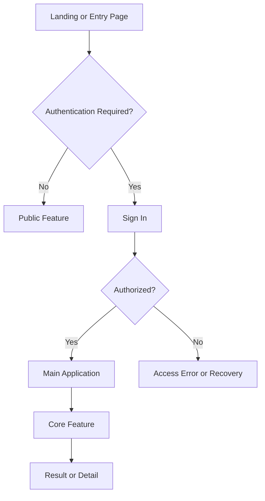
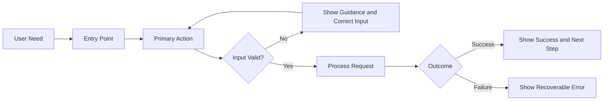
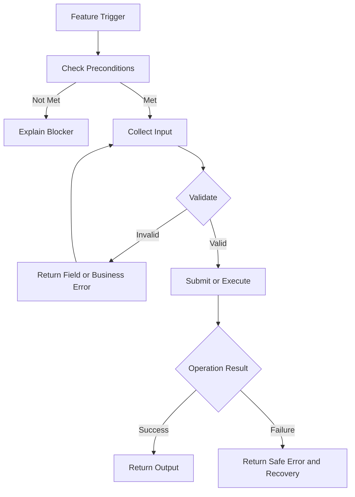
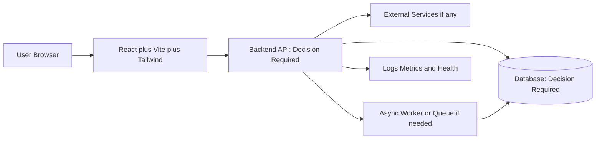
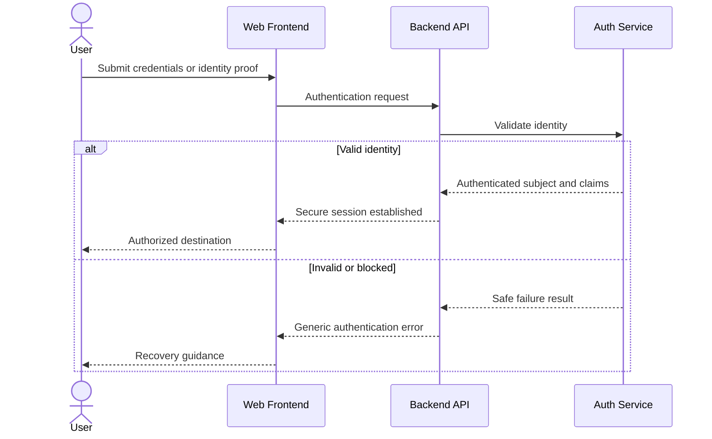
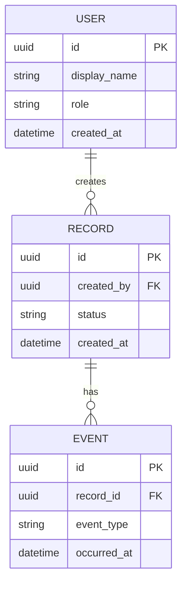
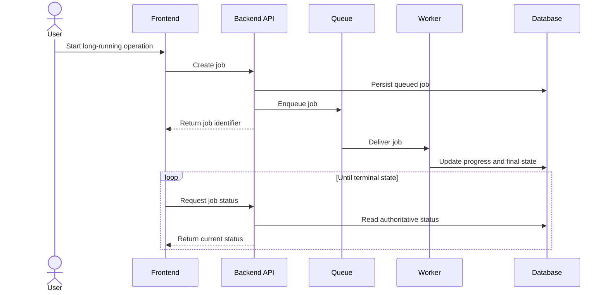
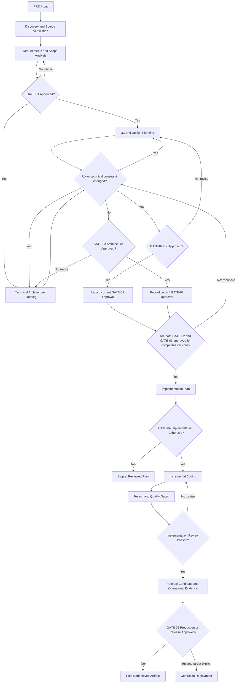

# Master Full-Stack Product Requirements Document Template

> **Status:** DRAFT v0.2 — Awaiting User Review<br>
> **Template type:** Design-first, full-stack, AI-assisted development blueprint<br>
> **Language:** English-first<br>
> **Default frontend preference:** React JS + Vite + Tailwind CSS<br>
> **Important:** Receiving this PRD does **not** authorize coding, database migration, deployment, or production changes.

---

## Start Here — How to Use This Master Template

This template is organized as:

```text
WHY -> SCOPE -> WHAT -> HOW -> VALIDATION
```

Use it as a master reference, not as a requirement to invent unnecessary complexity.

### First-time user path

1. Read **Document Control**, **Source-of-truth precedence**, and the **Stable ID registry**.
2. Select one profile: **Small/MVP**, **Standard Full-Stack**, or **Complex Application**.
3. Complete Sections **1–8** first. These establish the problem, users, scope, and unresolved decisions.
4. Stop for `GATE-01` requirements and scope review.
5. Complete Sections **9–15** for routes, features, pages, visual direction, wireframes, and flows.
6. Develop Sections **16–21** iteratively with UX work when technical constraints affect the design.
7. Obtain both `GATE-02` and `GATE-03`; neither gate replaces the other.
8. Complete Sections **23–26**, then prepare an implementation plan.
9. Obtain `GATE-04` before writing application code.
10. Obtain target-specific `GATE-05` approval before any production release or deployment action.

### Lightweight path for a Small/MVP project

A Small/MVP project does not need to expand every contract to maximum depth:

- keep Sections 1–8 concise but explicit;
- define only the active `CF-*`, `FR-*`, pages, routes, and critical states;
- use a compact traceability matrix for critical paths;
- include only wireframes and Mermaid diagrams that remove ambiguity;
- retain conditional sections and write `N/A — [RATIONALE]` instead of inventing a backend, database, authentication flow, or infrastructure;
- do not remove approval, security, acceptance, or Definition of Done boundaries.

### Mandatory versus conditional content

- **Mandatory reasoning:** document control, WHY, SCOPE, active features, applicable requirements, security/privacy baseline, acceptance, traceability, approval gates, and DoD.
- **Conditional implementation detail:** backend, API, database, authentication, async processing, uploads, integrations, deployment topology, and advanced operations.
- A conditional section remains visible. Use `N/A — [RATIONALE]` when it is not relevant and `DECISION REQUIRED` when it is unresolved.

### Placeholder workflow

1. Replace bracketed placeholders only with verified project facts.
2. Use `TBD` for unknown information that does not yet block work.
3. Use `DECISION REQUIRED` when a human decision blocks dependent work.
4. Use `N/A — [RATIONALE]` when a conditional concern was evaluated and is not applicable.
5. Do not fabricate users, metrics, routes, APIs, entities, controls, or deployment targets merely to fill the template.
6. Before approval, search for unresolved placeholders and record intentional exceptions.

### Navigation

- [Document Control](#document-control)
- [WHY — Sections 1–4](#i-why)
- [SCOPE — Sections 5–8](#ii-scope)
- [WHAT — Sections 9–12](#iii-what)
- [HOW — Sections 13–22](#iv-how)
- [VALIDATION — Sections 23–26](#v-validation)
- [Quick Start](#appendix-a--quick-start-for-a-new-project)
- [Self-Review Checklist](#appendix-b--prd-instance-self-review)

### Normative language

- **MUST:** mandatory for the approved scope.
- **SHOULD:** recommended; deviation requires a reason.
- **MAY:** optional.
- **TBD:** information is unknown and must be resolved.
- **DECISION REQUIRED:** a human decision blocks dependent work.
- **N/A — [RATIONALE]:** explicitly not applicable.

### Template instructions versus project content

Text prefixed with **Template instruction** explains how to fill the PRD and may be removed from a project instance. Text prefixed with **AI-agent instruction** defines behavior for an AI coding agent and should remain unless intentionally replaced by an approved project-specific rule.

### AI-agent entry protocol

Before planning implementation, an AI coding agent MUST:

1. identify the selected profile and delivery level;
2. summarize approved scope, non-goals, and unresolved `DEC-*` records;
3. validate relevant IDs and traceability;
4. identify the current approval gate;
5. stop if `GATE-04` is not explicitly approved for the requested implementation scope;
6. treat `GATE-05` as separate production/release authorization, never as an implication of `GATE-04`.

---

## Document Control

| Field | Value |
|---|---|
| Project name | `[PROJECT_NAME]` |
| Product description | `[PRODUCT_DESCRIPTION]` |
| PRD version | `0.2 / [NEXT_VERSION]` |
| Status | `DRAFT / IN REVIEW / APPROVED FOR DESIGN / APPROVED FOR IMPLEMENTATION / APPROVED FOR RELEASE / SUPERSEDED` |
| Project profile | `SMALL_MVP / STANDARD_FULLSTACK / COMPLEX` |
| Current delivery level | `DESIGN_FIRST / MVP / PRODUCTION_TARGET` |
| Product owner | `[PRODUCT_OWNER]` |
| Technical owner | `[TECHNICAL_OWNER]` |
| Design owner | `[DESIGN_OWNER]` |
| Security/data owner | `[SECURITY_DATA_OWNER]` |
| Created date | `[YYYY-MM-DD]` |
| Last updated | `[YYYY-MM-DD]` |
| Approved scope version | `TBD` |
| Repository | `N/A / [REPOSITORY_URL]` |
| Deployment target | `TBD / [DEPLOYMENT_TARGET]` |

### Revision history

| Version | Date | Author/owner | Summary | Approval impact |
|---|---|---|---|---|
| `0.2` | `[YYYY-MM-DD]` | `[OWNER]` | Targeted refinement and practical validation draft | All gates pending |

### Source-of-truth precedence

If project artifacts conflict, use this default order unless an approved decision record states otherwise:

1. Latest approved decision record (`DEC-*`).
2. Approved product intent and scope records (`PRINCIPLE-*`, `NEED-*`, `GOAL-*`, `METRIC-*`, `SCOPE-*`, `NON-GOAL-*`, `ROLE-*`).
3. Approved behavior and experience contracts (`FLOW-*`, `CF-*`, `FR-*`, `BR-*`, `PAGE-*`, `ROUTE-*`, `STATE-*`, `WF-*`, `COMP-*`, `NFR-*`).
4. Approved technical/security contracts (`SVC-*`, `API-*`, `DATA-*`, `INT-*`, `SEC-*`).
5. Approved acceptance and verification contracts (`AC-*`, `TEST-*`).
6. Approved assumptions, constraints, dependencies, and risks (`ASM-*`, `CON-*`, `DEP-*`, `RISK-*`).
7. Architecture/design explanation, diagram, wireframe, narrative prose, and illustrative example.

A lower-precedence artifact MUST NOT silently override a higher-precedence record. Resolve conflicts through `DEC-*`, update affected records, and re-review impacted gates.
A diagram, example, or mock MUST NOT silently override a canonical requirement.

### Placeholder registry

| Placeholder | Meaning | Required? |
|---|---|---:|
| `[PROJECT_NAME]` | Human-readable product name | Yes |
| `[PRODUCT_DESCRIPTION]` | One-sentence product description | Yes |
| `[TARGET_USERS]` | Verified target user groups | Yes |
| `[PRIMARY_PROBLEM]` | Core problem to solve | Yes |
| `[BACKEND_FRAMEWORK]` | Selected backend or `TBD/N/A` | Conditional |
| `[DATABASE_ENGINE]` | Selected database or `TBD/N/A` | Conditional |
| `[AUTH_STRATEGY]` | Authentication strategy or `N/A` | Conditional |
| `[DEPLOYMENT_TARGET]` | Target environment/platform or `TBD` | Conditional |
| `[PRIMARY_ROUTE]` | Main route/path | Conditional |
| `[PRIMARY_ENTITY]` | Main domain entity | Conditional |
| `[METRIC_TARGET]` | Approved success threshold | Conditional |

Project instances MAY add placeholders, but every placeholder must be understandable and must not resemble a real credential.

### Stable ID registry

| Namespace | Purpose | Required format | Valid example |
|---|---|---|---|
| `PRINCIPLE-*` | Product principle | `PRINCIPLE-NNN` | `PRINCIPLE-001` |
| `NEED-*` | User need | `NEED-NNN` | `NEED-001` |
| `GOAL-*` | Product goal | `GOAL-NNN` | `GOAL-001` |
| `METRIC-*` | Success/guardrail metric | `METRIC-NNN` | `METRIC-001` |
| `SCOPE-*` | In-scope item | `SCOPE-NNN` | `SCOPE-001` |
| `NON-GOAL-*` | Explicit exclusion | `NON-GOAL-NNN` | `NON-GOAL-001` |
| `ROLE-*` | User/system role | `ROLE-NNN` | `ROLE-001` |
| `FLOW-*` | User/system flow represented in text or Mermaid | `FLOW-NNN` | `FLOW-001` |
| `CF-*` | Core feature | `CF-NNN` | `CF-001` |
| `FR-*` | Atomic functional requirement | `FR-NNN` | `FR-001` |
| `BR-*` | Business rule | `BR-NNN` | `BR-001` |
| `PAGE-*` | Page/screen | `PAGE-NNN` | `PAGE-001` |
| `ROUTE-*` | Route | `ROUTE-NNN` | `ROUTE-001` |
| `STATE-*` | UI/domain state | `STATE-NNN` | `STATE-001` |
| `WF-*` | ASCII wireframe artifact | `WF-NNN` | `WF-001` |
| `COMP-*` | UI component contract | `COMP-NNN` | `COMP-001` |
| `NFR-*` | Categorized non-functional requirement | `NFR-CATEGORY-NNN` | `NFR-SEC-001` |
| `DATA-*` | Data entity/model | `DATA-NNN` | `DATA-001` |
| `SVC-*` | Backend service/module | `SVC-NNN` | `SVC-001` |
| `API-*` | API endpoint/event contract | `API-NNN` | `API-001` |
| `INT-*` | External integration contract | `INT-NNN` | `INT-001` |
| `SEC-*` | Security control | `SEC-NNN` | `SEC-001` |
| `AC-*` | Feature-linked acceptance criterion | `AC-CFNNN-NN` | `AC-CF001-01` |
| `TEST-*` | Feature-linked test/verification scenario | `TEST-CFNNN-NN` | `TEST-CF001-01` |
| `ASM-*` | Assumption | `ASM-NNN` | `ASM-001` |
| `CON-*` | Constraint | `CON-NNN` | `CON-001` |
| `DEP-*` | Dependency | `DEP-NNN` | `DEP-001` |
| `RISK-*` | Risk | `RISK-NNN` | `RISK-001` |
| `DEC-*` | Decision/open decision | `DEC-NNN` | `DEC-001` |
| `GATE-*` | Human approval gate | `GATE-NN` | `GATE-01` |
| `TRACE-EX-*` | Approved traceability exemption | `TRACE-EX-NNN` | `TRACE-EX-001` |

#### Stable ID rules

1. Each canonical ID MUST be unique within a PRD instance.
2. IDs are permanent references and MUST NOT be renumbered when sections move.
3. Retired IDs MUST remain reserved and MUST NOT be reused for another meaning.
4. `AC-CF001-01` and `TEST-CF001-01` are children of `CF-001`; digits `001` must match the parent feature. Their final `-01` suffixes are independent per-feature sequences and do not imply a pair unless the `TEST-*` contract explicitly references that `AC-*`.
5. Every `AC-*` MUST reference one or more `FR-*`; every `TEST-*` MUST reference one or more `AC-*` and state the evidence it is expected to produce.
6. Cross-references MUST use exact canonical IDs, not labels such as “the feature above.”
7. Placeholder tokens such as `[CF-IDS]` or `[WF-ID]` are instructions, not canonical IDs; replace or mark them intentionally unresolved before approval.
8. Diagrams and wireframes MUST list the applicable `FLOW-*`, `CF-*`, `PAGE-*`, `ROUTE-*`, `SVC-*`, `API-*`, `DATA-*`, `INT-*`, `SEC-*`, `NFR-*`, and `DEC-*` records they illustrate.
9. A traceability row links canonical records but MUST NOT redefine them.
10. A catalog row and its detailed contract are two views of one canonical record, not duplicate declarations; their name, scope, and references MUST agree. Two catalog rows or two detailed contracts with the same ID are duplicate declarations.
11. `NFR-*` MUST include a short uppercase category segment such as `SEC`, `PERF`, `A11Y`, or `REL`.
12. Duplicate declarations, malformed formats, and unresolved references are blocking validation failures for an approval candidate.

### Project profile activation matrix

| Area | Small/MVP | Standard Full-Stack | Complex Application |
|---|---|---|---|
| WHY and SCOPE | Required, concise | Required | Required with evidence |
| Feature/page contracts | Critical flows | All MVP flows | Full normal/alternate/failure flows |
| Backend/API/data | Conditional | Required for full-stack scope | Detailed contracts and lifecycle |
| ASCII wireframes | Actual critical pages | Main page families | Critical responsive/state variants |
| Mermaid | Global flow; architecture if relevant | Main flow + architecture + conditional diagrams | Full diagram set where useful |
| Traceability | Compact critical chain | Full MVP chain | Bidirectional full chain |
| Security/privacy | Baseline | Detailed | Threat/compliance depth |
| Operations | Target only | Environments, health, logs, rollback | SLO, recovery, incident ownership |

---

## I. WHY

### 1. Overview

**Purpose:** Provide a concise, truthful summary of the product and current document state.

**Template instruction:** Write for a reader who has never seen the project. Do not describe planned components as already implemented.

#### 1.1 Product summary

`[PROJECT_NAME]` is `[PRODUCT_DESCRIPTION]` for `[TARGET_USERS]`. It addresses `[PRIMARY_PROBLEM]` by `[HIGH_LEVEL_APPROACH]`.

#### 1.2 Product type and boundary

| Field | Value |
|---|---|
| Product type | `[PUBLIC_WEBSITE / DASHBOARD / ADMIN_SYSTEM / AI_APP / DOCUMENT_PLATFORM / OTHER]` |
| Primary user-facing surfaces | `[SURFACES]` |
| Internal/admin surfaces | `[SURFACES_OR_N/A]` |
| External systems | `[INTEGRATIONS_OR_N/A]` |
| Current state | `[IDEA / EXISTING_PROTOTYPE / LEGACY_REPLACEMENT / EXTENSION]` |
| Current phase | `[DISCOVERY / DESIGN_FIRST / IMPLEMENTATION / VALIDATION]` |

#### 1.3 One-paragraph current-phase statement

> This PRD currently defines `[CURRENT_SCOPE]`. It does not claim that `[UNIMPLEMENTED_COMPONENTS]` are implemented or production-ready.

**AI-agent instruction:** Summarize and identify unresolved decisions first. Do not begin coding from this overview alone.

---

### 2. Problem Statement

**Purpose:** Establish the verified problem before proposing features or technology.

#### 2.1 Primary problem

`[PRIMARY_PROBLEM]`

#### 2.2 Who experiences it

| User/group | Current task | Pain/friction | Evidence/source | Severity |
|---|---|---|---|---|
| `[TARGET_USER]` | `[TASK]` | `[PAIN]` | `[INTERVIEW/DATA/OBSERVATION/TBD]` | `[HIGH/MEDIUM/LOW]` |

#### 2.3 Current workaround and limitations

- Current workaround: `[CURRENT_WORKAROUND]`
- Why it is insufficient: `[LIMITATION]`
- Consequence if unresolved: `[IMPACT]`

#### 2.4 Problem evidence status

| Claim | Evidence | Confidence | Validation needed |
|---|---|---|---|
| `[PROBLEM_CLAIM]` | `[SOURCE_OR_TBD]` | `[HIGH/MEDIUM/LOW]` | `[NEXT_VALIDATION]` |

**Example:** “Staff copy records between spreadsheets” is a problem claim. “Build a dashboard” is a solution proposal and does not belong here.

**AI-agent instruction:** Do not convert assumptions into facts. Flag unsupported problem claims as `TBD`.

---

### 3. Product Vision & Value Proposition

**Purpose:** Define the intended future state and product principles without prescribing unnecessary implementation detail.

#### 3.1 Vision statement

> `[VISION_STATEMENT]`

#### 3.2 Value proposition

For `[TARGET_USER]` who needs `[USER_NEED]`, `[PROJECT_NAME]` provides `[VALUE]`, unlike `[CURRENT_ALTERNATIVE]`, because `[DIFFERENTIATOR]`.

#### 3.3 Product principles

| Principle ID | Principle | Practical implication |
|---|---|---|
| `PRINCIPLE-001` | `[PRINCIPLE]` | `[DESIGN/PRODUCT CONSEQUENCE]` |

#### 3.4 Desired and undesired product qualities

- Desired: `[TRUSTWORTHY / FAST / ACCESSIBLE / FORMAL / SIMPLE / OTHER]`
- Avoid: `[UNWANTED_PATTERN]`

**AI-agent instruction:** Use product principles to evaluate alternatives, not to invent branding or functionality.

---

### 4. User Needs, Outcomes & Success Metrics

**Purpose:** Connect human needs to measurable product outcomes.

#### 4.1 User needs

| Need ID | User/role | Need statement | Evidence | Priority |
|---|---|---|---|---|
| `NEED-001` | `ROLE-001` | As a `[USER]`, I need `[NEED]` so that `[OUTCOME]`. | `[SOURCE/TBD]` | `[MUST/SHOULD/COULD]` |

#### 4.2 Product outcomes

| Goal ID | Goal | Supported needs | Owner | Delivery level |
|---|---|---|---|---|
| `GOAL-001` | `[MEASURABLE_OR_VERIFIABLE_GOAL]` | `NEED-001` | `[OWNER]` | `[DESIGN_FIRST/MVP/PRODUCTION]` |

#### 4.3 Success metrics

| Metric ID | Goal | Metric | Baseline | Target | Method/source | Window | Owner |
|---|---|---|---|---|---|---|---|
| `METRIC-001` | `GOAL-001` | `[METRIC]` | `TBD` | `[METRIC_TARGET]` | `[MEASUREMENT_METHOD]` | `[PERIOD]` | `[OWNER]` |

#### 4.4 Guardrail metrics

Document negative outcomes that must not worsen, such as error rate, accessibility, privacy incidents, task completion time, operational cost, or support burden.

**AI-agent instruction:** If no numeric metric is appropriate, define a verifiable qualitative review method and approver. Never invent a baseline or target.

---

## II. SCOPE

### 5. Goals, Scope, Non-Goals & Release Boundaries

**Purpose:** Prevent scope drift and separate current delivery from future ideas.

#### 5.1 In scope

| Scope ID | Item | Related goal | Priority | Current release? |
|---|---|---|---|---|
| `SCOPE-001` | `[IN_SCOPE_ITEM]` | `GOAL-001` | `MUST` | `YES` |

#### 5.2 Non-goals / out of scope

| Non-goal ID | Excluded item | Reason | Revisit condition |
|---|---|---|---|
| `NON-GOAL-001` | `[OUT_OF_SCOPE_ITEM]` | `[RATIONALE]` | `[FUTURE_TRIGGER/NONE]` |

#### 5.3 Release boundaries

| Capability | Design-first | MVP | Production target | Future |
|---|---:|---:|---:|---:|
| `[CAPABILITY]` | `[YES/NO]` | `[YES/NO]` | `[YES/NO]` | `[YES/NO]` |

#### 5.4 Explicit anti-claims

- A design-first prototype MUST NOT be called production-ready.
- Mock authentication MUST NOT be described as production authentication.
- Dummy/local data MUST NOT be described as production persistence.
- Simulated progress MUST NOT be described as backend job truth.
- A proposed deployment target MUST NOT be described as deployed.

**AI-agent instruction:** Work only within the approved release column and stop when requested work crosses a non-goal or later release boundary.

---

### 6. Project Classification & Delivery Level

**Purpose:** Scale template depth to the project instead of forcing every section to maximum detail.

#### 6.1 Selected profile

- Project profile: `[SMALL_MVP / STANDARD_FULLSTACK / COMPLEX]`
- Delivery target: `[DESIGN_FIRST / MVP / PRODUCTION_TARGET]`
- Selection rationale: `[RATIONALE]`

Selection rule:

- Choose **Small/MVP** when scope is intentionally narrow, roles/integrations are limited, and compact critical-path contracts are sufficient.
- Choose **Standard Full-Stack** when the product has a real frontend, backend API, persistent data, and authentication/authorization or equivalent trust boundaries.
- Choose **Complex** when the system adds multiple data scopes, integrations, async processing, sensitive data, regulatory obligations, high availability, migration, or recovery complexity.
- When uncertain between profiles, select the smaller profile and record the unresolved complexity as `DECISION REQUIRED`; do not activate infrastructure speculatively.

#### 6.2 Complexity indicators

| Indicator | Value | Impact on PRD depth |
|---|---|---|
| Number of roles | `[COUNT/TBD]` | `[IMPACT]` |
| Persistent data | `[YES/NO/TBD]` | `[IMPACT]` |
| Authentication/RBAC | `[YES/NO/TBD]` | `[IMPACT]` |
| External integrations | `[COUNT/TBD]` | `[IMPACT]` |
| Async/long-running work | `[YES/NO/TBD]` | `[IMPACT]` |
| Sensitive/personal data | `[YES/NO/TBD]` | `[IMPACT]` |
| Regulatory constraints | `[YES/NO/TBD]` | `[IMPACT]` |
| Availability/scale needs | `[LEVEL/TBD]` | `[IMPACT]` |

#### 6.3 Active/conditional section record

| Section | Status | Rationale |
|---|---|---|
| Backend/Service Architecture | `[ACTIVE/N/A/TBD]` | `[RATIONALE]` |
| Data Model | `[ACTIVE/N/A/TBD]` | `[RATIONALE]` |
| Authentication | `[ACTIVE/N/A/TBD]` | `[RATIONALE]` |
| Deployment/Operations | `[ACTIVE/N/A/TBD]` | `[RATIONALE]` |

**AI-agent instruction:** Do not activate complex infrastructure merely because the master template contains a section for it.

---

### 7. Target Users, Roles & Permissions

**Purpose:** Define who uses the system, why, and what each actor may access.

#### 7.1 User/role catalog

| Role ID | Role | Needs | Responsibilities | Access zone | MVP/Future |
|---|---|---|---|---|---|
| `ROLE-001` | `[ROLE_NAME]` | `[NEED_IDS]` | `[RESPONSIBILITIES]` | `[PUBLIC/PRIVATE/ADMIN]` | `[MVP/FUTURE]` |
| `ROLE-002` | `[OPTIONAL_SECOND_ROLE]` | `[NEED_IDS]` | `[RESPONSIBILITIES]` | `[PUBLIC/PRIVATE/ADMIN]` | `[MVP/FUTURE]` |

#### 7.2 Permission and data-scope matrix

| Resource/action | `ROLE-001` | `ROLE-002` | Scope rule |
|---|---:|---:|---|
| View `[RESOURCE]` | `[ALLOW/DENY]` | `[ALLOW/DENY]` | `[OWN/TEAM/ALL/N/A]` |
| Create `[RESOURCE]` | `[ALLOW/DENY]` | `[ALLOW/DENY]` | `[RULE]` |
| Update `[RESOURCE]` | `[ALLOW/DENY]` | `[ALLOW/DENY]` | `[RULE]` |
| Delete `[RESOURCE]` | `[ALLOW/DENY]` | `[ALLOW/DENY]` | `[RULE]` |

#### 7.3 Public, authenticated, and privileged boundaries

- Public capabilities: `[LIST_OR_N/A]`
- Authenticated capabilities: `[LIST_OR_N/A]`
- Privileged/admin capabilities: `[LIST_OR_N/A]`
- Prohibited public actions: `[LIST]`

**AI-agent instruction:** Hiding a UI control is not authorization. Backend/service enforcement must exist for protected actions when a backend is in scope.

---

### 8. Assumptions, Constraints, Dependencies, Risks & Open Decisions

**Purpose:** Keep uncertainty visible and prevent an AI agent from filling gaps with guesses.

#### 8.1 Assumptions

| ID | Assumption | Validation method | Owner | Status |
|---|---|---|---|---|
| `ASM-001` | `[ASSUMPTION]` | `[HOW_TO_VALIDATE]` | `[OWNER]` | `[OPEN/VALIDATED/INVALID]` |

#### 8.2 Constraints

| ID | Constraint | Source | Impact |
|---|---|---|---|
| `CON-001` | `[TIME/BUDGET/TECH/LEGAL/BRAND_CONSTRAINT]` | `[SOURCE]` | `[IMPACT]` |

#### 8.3 Dependencies

| ID | Dependency | Type | Owner | Required by | Failure behavior |
|---|---|---|---|---|---|
| `DEP-001` | `[DEPENDENCY]` | `[INTERNAL/EXTERNAL]` | `[OWNER]` | `[DATE/PHASE]` | `[DEGRADE/BLOCK/RETRY]` |

#### 8.4 Risks

| ID | Risk | Likelihood | Impact | Mitigation | Owner | Trigger |
|---|---|---|---|---|---|---|
| `RISK-001` | `[RISK]` | `[L/M/H]` | `[L/M/H]` | `[MITIGATION]` | `[OWNER]` | `[SIGNAL]` |

#### 8.5 Decision register

| ID | Decision/question | Status | Options | Recommended option | Rationale | Owner | Blocks |
|---|---|---|---|---|---|---|---|
| `DEC-001` | `[QUESTION]` | `DECISION REQUIRED` | `[OPTIONS]` | `TBD` | `TBD` | `[OWNER]` | `[IDS]` |

**AI-agent instruction:** Stop and request a human decision when an open item affects scope, destructive data operations, authentication, authorization, privacy, migration, deployment, or production.

---

## III. WHAT

### 9. Information Architecture, Routes & User Journeys

**Purpose:** Define the product's navigable structure before detailed UI and implementation.

#### 9.1 Information architecture

```text
[PROJECT_NAME]
|
+-- Public
|   +-- [PAGE_NAME] ([ROUTE])
|
+-- Authenticated
|   +-- [PAGE_NAME] ([ROUTE])
|
+-- Admin (if applicable)
    +-- [PAGE_NAME] ([ROUTE])
```

#### 9.2 Route registry

| Route ID | Path | Page ID | Access | Purpose | Related features | Delivery level |
|---|---|---|---|---|---|---|
| `ROUTE-001` | `/` | `PAGE-001` | `PUBLIC` | `[PURPOSE]` | `CF-001` | `MVP` |
| `ROUTE-002` | `/[PATH]` | `PAGE-002` | `ROLE-001` | `[PURPOSE]` | `CF-002` | `MVP` |

#### 9.3 Journey registry

| Flow ID | Journey | Actor | Entry | Success destination | Failure/recovery |
|---|---|---|---|---|---|
| `FLOW-001` | `[JOURNEY_NAME]` | `ROLE-001` | `ROUTE-001` | `ROUTE-002` | `[RECOVERY]` |

#### 9.4 Navigation rules

- Primary navigation: `[ITEMS]`
- Secondary/context navigation: `[ITEMS_OR_N/A]`
- Back/cancel behavior: `[RULE]`
- Deep-link behavior: `[RULE]`
- Unauthorized route behavior: `[RULE]`
- Not-found behavior: `[RULE]`

**AI-agent instruction:** Do not create routes not present in the approved route registry unless explicitly authorized.

---

### 10. Core Features & Functional Requirements

**Purpose:** Define capabilities consistently and atomically.

#### 10.1 Core feature catalog

| Feature ID | Name | Outcome | Primary role | Priority | Delivery level | Status |
|---|---|---|---|---|---|---|
| `CF-001` | `[FEATURE_NAME]` | `[USER_OUTCOME]` | `ROLE-001` | `MUST` | `MVP` | `DRAFT` |
| `CF-002` | `[OPTIONAL_SECOND_FEATURE]` | `[USER_OUTCOME]` | `ROLE-002` | `[PRIORITY]` | `[LEVEL]` | `DRAFT` |

#### 10.2 Reusable core feature contract

##### CF-001 — `[FEATURE_NAME]`

| Field | Contract |
|---|---|
| Description | `[WHAT_THE_FEATURE_DOES]` |
| User need | `NEED-001` |
| Goal | `GOAL-001` |
| User role | `ROLE-001` |
| Trigger/entry point | `[TRIGGER]` |
| Preconditions | `[PRECONDITIONS_OR_NONE]` |
| Main workflow | `FLOW-001` or `[ORDERED_STEPS]` |
| Alternate workflow | `[ALTERNATE_STEPS_OR_N/A]` |
| Inputs | `[INPUTS]` |
| Outputs | `[OUTPUTS]` |
| Business rules | `BR-001` |
| Validation rules | `[RULES]` |
| Success states | `STATE-001` |
| Error/empty states | `STATE-002, STATE-003` |
| Page/route | `PAGE-001 / ROUTE-001` |
| API dependencies | `API-001 / N/A` |
| Data dependencies | `DATA-001 / N/A` |
| Security/NFR | `NFR-SEC-001, NFR-PERF-001` |
| Acceptance criteria | `AC-CF001-01` |
| Priority | `[MUST/SHOULD/COULD/WONT]` |
| Delivery level | `[DESIGN_FIRST/MVP/PRODUCTION/FUTURE]` |
| Open decisions | `[DEC-IDS/NONE]` |

#### 10.3 Atomic functional requirements

| FR ID | Feature | Requirement | Priority | Preconditions | Verification |
|---|---|---|---|---|---|
| `FR-001` | `CF-001` | The system MUST `[ATOMIC_BEHAVIOR]`. | `MUST` | `[CONDITION]` | `AC-CF001-01` |

#### 10.4 Business rules

| BR ID | Rule | Source/owner | Applies to | Failure behavior |
|---|---|---|---|---|
| `BR-001` | `[BUSINESS_RULE]` | `[OWNER/SOURCE]` | `CF-001, API-001` | `[REJECT/WARN/REVIEW]` |

**AI-agent instruction:** Implement only approved `FR-*` items. If prose and a feature table conflict, flag the conflict instead of choosing silently.

---

### 11. Non-Functional Requirements

**Purpose:** Make quality requirements measurable rather than aspirational.

#### 11.1 NFR registry

| NFR ID | Category | Requirement/target | Measurement | Applies to | Delivery level |
|---|---|---|---|---|---|
| `NFR-PERF-001` | Performance | `[TARGET_OR_TBD]` | `[METHOD]` | `[ROUTES/APIS]` | `[MVP/PRODUCTION]` |
| `NFR-SEC-001` | Security | `[REQUIREMENT]` | `[TEST/REVIEW]` | `[SYSTEM_AREA]` | `[LEVEL]` |
| `NFR-A11Y-001` | Accessibility | WCAG `[LEVEL]` target | `[AUDIT_METHOD]` | All user-facing pages | `[LEVEL]` |

#### 11.2 Required categories

Record a requirement or `N/A — [RATIONALE]` for:

- performance and latency;
- security;
- privacy/data protection;
- accessibility;
- responsive/device/browser compatibility;
- reliability/availability;
- scalability/capacity;
- maintainability;
- observability/auditability;
- localization/timezone/currency;
- SEO/content discoverability;
- operational cost or resource limits.

#### 11.3 Responsive requirements

| Viewport/device | Global behavior | Navigation | Tables/forms | Exceptions |
|---|---|---|---|---|
| Mobile | `[RULE]` | `[RULE]` | `[RULE]` | `[PAGE_IDS]` |
| Tablet | `[RULE]` | `[RULE]` | `[RULE]` | `[PAGE_IDS]` |
| Desktop | `[RULE]` | `[RULE]` | `[RULE]` | `[PAGE_IDS]` |

**AI-agent instruction:** Words such as “fast,” “secure,” “scalable,” or “responsive” require a metric or explicit review method.

---

### 12. Page/Route Specifications & UI States

**Purpose:** Define what each page must communicate and support, without treating a wireframe as the sole requirement.

#### 12.1 Page registry

| Page ID | Name | Route | Actor | Purpose | Features | Required? |
|---|---|---|---|---|---|---|
| `PAGE-001` | `[PAGE_NAME]` | `ROUTE-001` | `ROLE-001` | `[PURPOSE]` | `CF-001` | `YES` |
| `PAGE-002` | `[OPTIONAL_SECOND_PAGE]` | `ROUTE-002` | `ROLE-001 / ROLE-002` | `[PURPOSE]` | `CF-002` | `[YES/NO]` |

#### 12.2 Reusable page specification

##### PAGE-001 — `[PAGE_NAME]`

| Field | Specification |
|---|---|
| Route | `ROUTE-001` |
| Users/roles | `ROLE-001` |
| Purpose | `[PAGE_PURPOSE]` |
| Entry points | `[ROUTES/ACTIONS]` |
| Exit points | `[ROUTES/ACTIONS]` |
| Main regions | `[HEADER/NAV/CONTENT/SIDEBAR/FOOTER]` |
| Primary CTA | `[CTA_OR_N/A]` |
| Secondary actions | `[ACTIONS_OR_N/A]` |
| Inputs | `[FIELDS_OR_N/A]` |
| Data displayed | `[DATA_FIELDS_OR_N/A]` |
| Validation | `[RULES_OR_N/A]` |
| Permissions | `[RULES]` |
| Responsive behavior | `[MOBILE/TABLET/DESKTOP_RULES]` |
| Accessibility | `[SEMANTICS/FOCUS/LABELS/ANNOUNCEMENTS]` |
| Analytics | `[EVENTS_OR_N/A]` |
| Related wireframe | `[WF-ID/N/A]` |
| Acceptance criteria | `[AC-IDS]` |

#### 12.3 Canonical UI state catalog

| State ID | State | Trigger | User message | Available actions | Recovery/source of truth |
|---|---|---|---|---|---|
| `STATE-001` | Loading | `[TRIGGER]` | `[COPY]` | `[CANCEL/NONE]` | `[RULE]` |
| `STATE-002` | Empty | `[TRIGGER]` | `[COPY]` | `[PRIMARY_ACTION]` | `[RULE]` |
| `STATE-003` | Validation error | `[TRIGGER]` | `[COPY]` | `[CORRECT_INPUT]` | `[RULE]` |
| `STATE-004` | Permission denied | `[TRIGGER]` | `[COPY]` | `[BACK/LOGIN]` | `[RULE]` |
| `STATE-005` | Server/network error | `[TRIGGER]` | `[COPY]` | `[RETRY/SUPPORT]` | `[RULE]` |
| `STATE-006` | Success | `[TRIGGER]` | `[COPY]` | `[NEXT_ACTION]` | `[RULE]` |

**AI-agent instruction:** Every significant data-driven page must handle loading, empty, success, validation, permission, and server/network failure as applicable.

---

## IV. HOW

### 13. Visual Direction & Design System

**Purpose:** Translate product values into adaptable visual rules without forcing a brand or color palette.

#### 13.1 Visual identity

| Field | Value |
|---|---|
| Brand/product personality | `[KEYWORDS]` |
| Desired impression | `[IMPRESSION]` |
| Domain motif | `[MOTIF_OR_N/A]` |
| Existing brand constraints | `[CONSTRAINTS_OR_NONE]` |
| What to avoid | `[ANTI_PATTERNS]` |
| Reference assets | `[LINKS/FILES_OR_TBD]` |

#### 13.2 Design tokens

| Token group | Token/example | Project value | Usage rule |
|---|---|---|---|
| Color | `--color-primary` | `[HEX/TBD]` | `[USAGE]` |
| Typography | `--font-sans` | `[FONT/TBD]` | `[USAGE]` |
| Spacing | `--space-4` | `[VALUE/TBD]` | `[USAGE]` |
| Radius | `--radius-card` | `[VALUE/TBD]` | `[USAGE]` |
| Shadow | `--shadow-card` | `[VALUE/TBD]` | `[USAGE]` |
| Motion | `--duration-normal` | `[VALUE/TBD]` | Respect reduced motion |

#### 13.3 Component inventory

| Component ID | Component | Variants | States | Accessibility contract | Used by pages |
|---|---|---|---|---|---|
| `COMP-001` | Button | `[PRIMARY/SECONDARY/DANGER]` | `[DEFAULT/HOVER/FOCUS/DISABLED/LOADING]` | `[RULE]` | `[PAGE_IDS]` |

Suggested categories:

- Layout: header, sidebar, footer, container, grid.
- Navigation: navbar, breadcrumbs, tabs, pagination.
- Input: input, select, checkbox, radio, date picker, upload/dropzone.
- Feedback: alert, toast, modal, progress, status badge.
- Data: card, table, list, chart, detail panel.
- States: skeleton, empty, error, permission denied, success.

#### 13.4 Accessibility and responsive design

- Target: `[WCAG_LEVEL]`.
- Keyboard behavior: `[RULES]`.
- Focus management: `[RULES]`.
- Color contrast: `[TARGET]`.
- Non-color status cues: `[RULES]`.
- Reduced motion: `[RULES]`.
- Dark mode: `N/A / OPTIONAL / REQUIRED — [RATIONALE]`.
- Breakpoints: `[TAILWIND_DEFAULTS / CUSTOM / DECISION REQUIRED]`.

**AI-agent instruction:** Do not invent a color palette or brand. Use tokens and values approved in this section.

---

### 14. ASCII Wireframes

**Purpose:** Describe layout, content hierarchy, controls, and responsive transformation before implementation.

**Usage rule:** Include only page patterns actually required by the project. If a pattern is not needed, mark it `N/A — [RATIONALE]`. Wireframes illustrate page contracts and must reference `PAGE-*`, `ROUTE-*`, and `CF-*` records.

#### 14.1 Wireframe metadata template

| Field | Value |
|---|---|
| Wireframe ID | `[WF-001]` |
| Page/route | `[PAGE-001 / ROUTE-001]` |
| Features | `[CF-IDS]` |
| Viewport | `[DESKTOP/MOBILE]` |
| State | `[DEFAULT/LOADING/EMPTY/ERROR/SUCCESS]` |
| Notes | `[INTERACTION_NOTES]` |

#### 14.2 Landing/Home Page pattern

```text
+--------------------------------------------------------------------------------+
| [LOGO] [PROJECT_NAME]          [NAV ITEMS]                 [LOGIN] [PRIMARY CTA]|
+--------------------------------------------------------------------------------+
| HERO                                                                           |
| [EYEBROW]                                                                      |
| [PRIMARY VALUE PROPOSITION]             +------------------------------------+ |
| [SUPPORTING COPY]                       | [DOMAIN VISUAL / PRODUCT PREVIEW]  | |
| [PRIMARY CTA] [SECONDARY CTA]           +------------------------------------+ |
+--------------------------------------------------------------------------------+
| TRUST / KEY BENEFITS: [CARD] [CARD] [CARD]                                     |
+--------------------------------------------------------------------------------+
| HOW IT WORKS: [STEP 1] -> [STEP 2] -> [STEP 3]                                |
+--------------------------------------------------------------------------------+
| [OPTIONAL CONTENT / PARTNERS / FAQ]                                             |
+--------------------------------------------------------------------------------+
| FOOTER: [CONTACT] [POLICY] [STATUS]                                             |
+--------------------------------------------------------------------------------+
```

#### 14.3 Login/Authentication pattern

```text
+---------------------------------------------------------------+
| [PUBLIC HEADER / BRAND]                                       |
+---------------------------------------------------------------+
|                                                               |
|             +-----------------------------------+             |
|             | [ICON / LOGO]                     |             |
|             | [LOGIN TITLE]                     |             |
|             | [SUPPORTING TEXT]                 |             |
|             |                                   |             |
|             | Email / Username                  |             |
|             | [_______________________________] |             |
|             | Password                    [SHOW]|             |
|             | [_______________________________] |             |
|             | [FIELD / AUTH ERROR]              |             |
|             |                                   |             |
|             | [          SIGN IN             ]  |             |
|             | [FORGOT PASSWORD / BACK LINK]     |             |
|             +-----------------------------------+             |
|                                                               |
+---------------------------------------------------------------+
```

#### 14.4 Main Dashboard pattern

```text
+----------------------+---------------------------------------------------------+
| [BRAND]              | [PAGE TITLE]                         [USER] [ACTIONS]    |
|----------------------|---------------------------------------------------------|
| [NAV ITEM]           | [STAT CARD] [STAT CARD] [STAT CARD] [STAT CARD]        |
| [NAV ITEM]           |                                                         |
| [NAV ITEM]           | +---------------------------+ +-----------------------+ |
| [NAV ITEM]           | | [PRIMARY WORK AREA]       | | [SECONDARY PANEL]     | |
|                      | | [CHART / SUMMARY / CTA]   | | [ALERTS / QUICK INFO] | |
|                      | +---------------------------+ +-----------------------+ |
|                      |                                                         |
| [ACCOUNT / LOGOUT]   | [RECENT ACTIVITY / DATA TABLE / EMPTY STATE]           |
+----------------------+---------------------------------------------------------+
```

#### 14.5 Data/List Page pattern

```text
+--------------------------------------------------------------------------------+
| [PAGE TITLE] [COUNT]                                  [CREATE] [EXPORT/OTHER]   |
| [DESCRIPTION]                                                                  |
+--------------------------------------------------------------------------------+
| [SEARCH________________] [FILTER] [STATUS] [DATE] [SORT] [CLEAR]               |
+--------------------------------------------------------------------------------+
| [BULK ACTIONS when selected]                                                   |
|--------------------------------------------------------------------------------|
| [ ] | COLUMN A | COLUMN B | STATUS | UPDATED | OWNER | ACTIONS                 |
| [ ] | [VALUE]  | [VALUE]  | [BADGE]| [DATE]  | [NAME]| [VIEW] [...]           |
|--------------------------------------------------------------------------------|
| [EMPTY / LOADING / ERROR / PERMISSION STATE replaces rows when applicable]     |
+--------------------------------------------------------------------------------+
| [RESULT COUNT]                                      [PREV] [1] [2] [NEXT]     |
+--------------------------------------------------------------------------------+
```

#### 14.6 Create/Edit Form pattern

```text
+--------------------------------------------------------------------------------+
| [BACK] [CREATE/EDIT TITLE]                                   [SAVE STATUS]     |
| [HELP TEXT]                                                                    |
+--------------------------------------------------------------------------------+
| [SECTION / STEPPER if multi-step]                                               |
|                                                                                |
| Label *                                                                        |
| [____________________________________________________________________________] |
| Help text / validation error                                                   |
|                                                                                |
| Label                          Label                                            |
| [___________________________]  [_____________________________________________] |
|                                                                                |
| [UPLOAD / RICH INPUT / CONDITIONAL FIELDS if applicable]                       |
|                                                                                |
| [CANCEL]                                         [SAVE DRAFT] [SUBMIT/SAVE]    |
+--------------------------------------------------------------------------------+
| [UNSAVED-CHANGES MODAL / SERVER ERROR / SUCCESS FEEDBACK]                      |
+--------------------------------------------------------------------------------+
```

#### 14.7 Detail/Result Page pattern

```text
+--------------------------------------------------------------------------------+
| [BACK] [ENTITY / RESULT TITLE]          [STATUS BADGE]      [EDIT] [MORE]      |
| [PRIMARY IDENTIFIER] [CREATED/UPDATED INFO]                                    |
+--------------------------------------------------------------------------------+
| +-----------------------------------------+ +--------------------------------+ |
| | [PRIMARY CONTENT / PREVIEW / SUMMARY]   | | [KEY DETAILS]                  | |
| |                                         | | Field: [VALUE]                 | |
| | [RESULT MESSAGE / VISUALIZATION]        | | Field: [VALUE]                 | |
| +-----------------------------------------+ +--------------------------------+ |
|                                                                                |
| [TABS: OVERVIEW | HISTORY | RELATED | AUDIT]                                   |
| [TAB CONTENT / TIMELINE / RELATED DATA]                                        |
+--------------------------------------------------------------------------------+
| [SECONDARY ACTION]                                      [PRIMARY NEXT ACTION]  |
+--------------------------------------------------------------------------------+
```

#### 14.8 Mobile reusable pattern

```text
+----------------------------------+
| [MENU] [PAGE TITLE]      [USER]  |
+----------------------------------+
| [PRIMARY STATUS / SUMMARY]       |
|                                  |
| [PRIMARY CTA - FULL WIDTH]       |
|                                  |
| [CARD / SECTION 1]               |
| [CARD / SECTION 2]               |
| [CARD / SECTION 3]               |
|                                  |
| [TABLE -> CARD LIST / H-SCROLL]  |
|                                  |
| [STICKY ACTION if justified]     |
+----------------------------------+
| [OPTIONAL BOTTOM NAVIGATION]     |
+----------------------------------+
```

#### 14.9 Responsive transformation notes

For every active wireframe, document:

- navigation collapse/drawer behavior;
- column stacking order;
- table-to-card or horizontal-scroll rule;
- modal-to-fullscreen behavior;
- sticky action behavior;
- hidden/deferred secondary content;
- touch target and keyboard behavior;
- mobile error/loading/empty states.

**AI-agent instruction:** Do not treat decorative spacing in ASCII as pixel-exact. Preserve hierarchy, controls, states, and relationships.

---

### 15. Mermaid Diagram Set

**Purpose:** Provide reusable behavior and architecture diagrams. Every diagram is a proposal until approved and MUST remain consistent with canonical requirements.

#### 15.0 Diagram metadata and cross-reference contract

Place this table immediately before or after each active project diagram:

| Field | Value |
|---|---|
| Diagram purpose | `[GLOBAL_FLOW / USER_JOURNEY / FEATURE_FLOW / ARCHITECTURE / AUTH / ERD / SEQUENCE]` |
| Status | `PROPOSED / APPROVED DESIGN / IMPLEMENTED AND VERIFIED` |
| Canonical flow | `[FLOW-IDS / N/A]` |
| Features | `[CF-IDS / N/A]` |
| Pages/routes | `[PAGE-IDS / ROUTE-IDS / N/A]` |
| Services/APIs/data | `[SVC-IDS / API-IDS / DATA-IDS / N/A]` |
| Integrations/security/NFR | `[INT-IDS / SEC-IDS / NFR-IDS / N/A]` |
| Decisions | `[DEC-IDS / NONE]` |

The metadata—not node names—is the canonical cross-reference. The diagram illustrates those records and MUST be updated when an approved referenced contract changes.

#### 15.1 Global App Flow



**Use for:** High-level product navigation. Replace labels and cross-reference `ROUTE-*`/`FLOW-*` in accompanying text.

#### 15.2 User Journey



**Use for:** One actor's end-to-end journey including recovery.

#### 15.3 Core Feature Workflow



**Use for:** `CF-*` workflows with alternate/error branches.

#### 15.4 Full-Stack System Architecture



**Use for:** Proposed boundaries only. Remove components that are not needed; do not imply implementation.

#### 15.5 Authentication Flow — Conditional



**Use for:** Projects requiring authentication. Session/token details remain `DECISION REQUIRED` until approved.

#### 15.6 Database ERD — Conditional



**Use for:** Relational persistence. Replace sample entities; keep cardinalities consistent with Section 16.

#### 15.7 API / Async Processing Sequence — Conditional



**Use for:** Long-running operations. Do not include if synchronous processing is sufficient.

#### 15.8 Diagram consistency checklist

- [ ] Every diagram has a stated purpose.
- [ ] Every implemented-looking component is labeled as proposed if not implemented.
- [ ] Diagram labels match route/feature/API/data contracts.
- [ ] Error and unauthorized branches are represented where relevant.
- [ ] Conditional diagrams are removed or marked N/A when not needed.
- [ ] Mermaid renders successfully in the chosen renderer before final approval.

---

### 16. Domain, State & Data Model

**Purpose:** Define domain concepts, data ownership, lifecycle, and persistence decisions before schema implementation.

#### 16.1 Domain glossary

| Term | Definition | Source/owner | Avoid/conflicts |
|---|---|---|---|
| `[TERM]` | `[DEFINITION]` | `[OWNER]` | `[AMBIGUOUS_TERMS]` |

#### 16.2 Entity catalog

| Data ID | Entity | Purpose | Source of truth | Persistence | Classification | Owner |
|---|---|---|---|---|---|---|
| `DATA-001` | `[ENTITY_NAME]` | `[PURPOSE]` | `[SERVICE/DB/EXTERNAL]` | `[YES/NO/TBD]` | `[PUBLIC/INTERNAL/PERSONAL/SENSITIVE]` | `[OWNER]` |

#### 16.3 Entity contract

##### DATA-001 — `[ENTITY_NAME]`

| Field | Type | Required | Constraints/default | Classification | Exposed by API? |
|---|---|---:|---|---|---:|
| `id` | `[UUID/INTEGER/OTHER]` | Yes | Unique; generated by `[SOURCE]` | Internal | Yes |
| `[FIELD]` | `[TYPE]` | `[Y/N]` | `[CONSTRAINTS]` | `[CLASS]` | `[Y/N]` |

Relationships:

- `[DATA-001] [CARDINALITY] [DATA-002]` because `[RULE]`.

Lifecycle:

```text
[INITIAL] -> [ACTIVE] -> [TERMINAL/ARCHIVED]
```

Deletion/retention:

- Retention: `[PERIOD/POLICY/TBD]`
- Delete semantics: `[HARD/SOFT/ANONYMIZE/ARCHIVE]`
- Backup implications: `[RULE/TBD]`

#### 16.4 Database decision

| Field | Decision |
|---|---|
| Persistence required? | `[YES/NO/DECISION REQUIRED]` |
| Database engine | `[DATABASE_ENGINE]` |
| Rationale | `[DATA_SHAPE/TRANSACTION/OPERATIONS_REASON]` |
| Alternatives considered | `[POSTGRESQL/MYSQL/SQLITE/NOSQL/OTHER]` |
| Migration strategy | `[TOOL/APPROACH/TBD/N/A]` |
| Indexing considerations | `[QUERIES/CONSTRAINTS/TBD]` |
| Seed/reference data | `[APPROACH/N/A]` |

**AI-agent instruction:** Do not create a database or migration merely because this section exists. Persistence and engine choices require approval.

---

### 17. Backend/Service Architecture

**Purpose:** Define service responsibilities and boundaries without forcing one framework.

#### 17.1 Backend decision

| Field | Decision |
|---|---|
| Backend required? | `[YES/NO/DECISION REQUIRED]` |
| Framework | `[BACKEND_FRAMEWORK]` |
| Candidate examples | `FastAPI / Node.js + Express / other` |
| Selection rationale | `[TEAM/DOMAIN/PERFORMANCE/ECOSYSTEM_REASON]` |
| Architecture style | `[MODULAR_MONOLITH/MONOLITH/SERVICES/OTHER]` |
| Async processing | `[N/A/QUEUE/WORKER/OTHER/TBD]` |

#### 17.2 Service/module responsibilities

| Service/module ID | Responsibility | Owns data | Exposes | Must not do |
|---|---|---|---|---|
| `SVC-001` | `[RESPONSIBILITY]` | `[DATA_IDS/NONE]` | `[API/EVENTS]` | `[BOUNDARY]` |

#### 17.3 Business logic and validation placement

- Domain/business rules enforced by: `[LAYER]`.
- Request shape validation enforced by: `[LAYER]`.
- Authorization enforced by: `[LAYER]`.
- Transaction boundary: `[RULE]`.
- Error mapping: `[ERROR_MODEL]`.
- Idempotency/concurrency: `[RULE_OR_N/A]`.

#### 17.4 Failure and resilience behavior

| Failure | Expected behavior | User impact | Retry/fallback | Logging/alert |
|---|---|---|---|---|
| `[DEPENDENCY_TIMEOUT]` | `[BEHAVIOR]` | `[IMPACT]` | `[RULE]` | `[RULE]` |

**AI-agent instruction:** Keep backend decisions flexible until approved. A frontend-first prototype may use mock services, but mock behavior must be isolated and labeled non-production.

---

### 18. API & Integration Contracts

**Purpose:** Make frontend/backend and external boundaries explicit and testable.

#### 18.1 API registry

| API ID | Method | Path/event | Purpose | Auth | Feature | Data | Status |
|---|---|---|---|---|---|---|---|
| `API-001` | `GET` | `/api/[RESOURCE]` | `[PURPOSE]` | `[PUBLIC/ROLE]` | `CF-001` | `DATA-001` | `DRAFT` |

#### 18.2 Reusable endpoint contract

##### API-001 — `[ENDPOINT_NAME]`

| Field | Contract |
|---|---|
| Method/path | `[METHOD] [PATH]` |
| Purpose | `[PURPOSE]` |
| Authentication | `[RULE/N/A]` |
| Authorization | `[ROLE/DATA_SCOPE]` |
| Path/query parameters | `[SCHEMA/N/A]` |
| Request body | `[SCHEMA/N/A]` |
| Success response | `[STATUS + SCHEMA]` |
| Error responses | `[400/401/403/404/409/422/429/5XX AS APPLICABLE]` |
| Validation/business rules | `[BR/FR IDS]` |
| Idempotency | `[RULE/N/A]` |
| Pagination/filter/sort | `[CONTRACT/N/A]` |
| Rate limit | `[RULE/TBD/N/A]` |
| Observability | `[LOG/METRIC/TRACE RULE]` |
| Related feature/page/data | `[IDS]` |
| Acceptance/tests | `[AC/TEST IDS]` |

#### 18.3 Error envelope

```json
{
  "error": {
    "code": "[STABLE_ERROR_CODE]",
    "message": "[SAFE_USER_MESSAGE]",
    "field_errors": [],
    "request_id": "[OPAQUE_REQUEST_ID]"
  }
}
```

Do not expose stack traces, secrets, SQL, internal paths, or sensitive identifiers.

#### 18.4 External integration contract

| Integration ID | Provider/system | Data sent | Data received | Auth | Timeout/retry | Failure behavior | Owner |
|---|---|---|---|---|---|---|---|
| `INT-001` | `[SYSTEM]` | `[FIELDS]` | `[FIELDS]` | `[METHOD]` | `[RULE]` | `[RULE]` | `[OWNER]` |

**AI-agent instruction:** Do not invent endpoints from page controls. Every data operation must map to an approved API contract or be explicitly client-only/static.

---

### 19. Frontend & Component Architecture

**Purpose:** Document the preferred frontend stack, boundaries, routes, state, forms, services, and reusable components.

#### 19.1 Default frontend stack

| Concern | Default/preference | Project decision and rationale |
|---|---|---|
| UI framework | React JS functional components | `[ACCEPT/OVERRIDE + RATIONALE]` |
| Build tool | Vite | `[ACCEPT/OVERRIDE + RATIONALE]` |
| Styling | Tailwind CSS | `[ACCEPT/OVERRIDE + RATIONALE]` |
| Routing | React Router when routing is needed | `[YES/NO + RATIONALE]` |
| Icons | Lucide React when icons are needed | `[YES/NO + RATIONALE]` |
| Server-state/data fetching | `[NATIVE FETCH/TANSTACK QUERY/OTHER/TBD]` | `[RATIONALE]` |
| Forms/validation | `[REACT HOOK FORM/ZOD/OTHER/TBD]` | `[RATIONALE]` |
| Global/client state | `[LOCAL/CONTEXT/STORE/OTHER/TBD]` | `[RATIONALE]` |

**Conditional recommendations:** TanStack Query MAY be selected for server-state caching and mutation coordination; React Hook Form MAY be selected for complex forms; Zod MAY be selected for client-side schemas. They are not mandatory dependencies and must be justified per project.

#### 19.2 Architecture rules

- Use React functional components.
- Separate UI, client state, server state, and data services.
- Keep feature/domain logic out of generic visual components.
- Centralize API/error handling.
- Use reusable components where behavior/design is genuinely shared.
- Avoid premature abstraction.
- Make loading, empty, error, success, disabled, and permission states explicit.
- Preserve accessibility and responsive behavior.

#### 19.3 Component hierarchy

```text
App
+-- Router (if required)
    +-- PublicLayout
    |   +-- [PUBLIC_PAGES]
    +-- AuthenticatedLayout
        +-- [AUTHENTICATED_PAGES]
        +-- SharedComponents
```

#### 19.4 Suggested source structure — adapt, do not copy blindly

```text
src/
+-- app/
+-- assets/
+-- components/
|   +-- common/
+-- features/
|   +-- [feature-name]/
|       +-- components/
|       +-- hooks/
|       +-- services/
|       +-- types-or-schemas/
+-- layouts/
+-- pages/
+-- routes/
+-- services/
+-- styles/
+-- utils/
+-- main.jsx
```

#### 19.5 Forms and API integration

| Concern | Decision |
|---|---|
| Field validation | `[CLIENT + SERVER RULES]` |
| Submission state | `[RULE]` |
| Duplicate submission prevention | `[RULE]` |
| Optimistic updates | `[N/A/RULE]` |
| Error mapping | `[FIELD/FORM/GLOBAL RULE]` |
| Retry/cancel | `[RULE]` |
| File upload | `[N/A/CONTRACT]` |

**AI-agent instruction:** For a design-first prototype, mock data/services must be isolated and clearly replaceable. Do not call a mock login or local array a production backend.

---

### 20. Authentication, Security & Privacy

**Purpose:** Define trust boundaries and mandatory controls appropriate to the delivery level.

#### 20.1 Authentication strategy

| Field | Decision |
|---|---|
| Authentication required? | `[YES/NO/DECISION REQUIRED]` |
| Strategy | `[AUTH_STRATEGY]` |
| Identity provider | `[INTERNAL/EXTERNAL/N/A/TBD]` |
| Session/token storage | `[HTTPONLY_COOKIE/OTHER/TBD]` |
| Login recovery | `[FLOW/N/A/TBD]` |
| MFA | `[REQUIRED/OPTIONAL/N/A/TBD]` |
| Prototype behavior | `[MOCK/NONE]`, explicitly non-production |

#### 20.2 Authorization/RBAC

- Backend/service authorization is mandatory for protected operations.
- Role and resource scope: see Section 7.
- Denied behavior: `[403/404 POLICY]`.
- Privilege changes: `[AUDIT/APPROVAL RULE]`.

#### 20.3 Security control checklist

| Security ID | Control | Required level | Verification | Status |
|---|---|---|---|---|
| `SEC-001` | Password/credential protection | `[LEVEL]` | `[METHOD]` | `TBD` |
| `SEC-002` | Input validation | `[LEVEL]` | `[METHOD]` | `TBD` |
| `SEC-003` | Rate/abuse limiting | `[LEVEL/N/A]` | `[METHOD]` | `TBD` |
| `SEC-004` | CORS/CSRF strategy | `[LEVEL/N/A]` | `[METHOD]` | `TBD` |
| `SEC-005` | Safe error handling | `[LEVEL]` | `[METHOD]` | `TBD` |
| `SEC-006` | Secret handling | `[LEVEL]` | `[METHOD]` | `TBD` |
| `SEC-007` | Audit logging | `[LEVEL/N/A]` | `[METHOD]` | `TBD` |
| `SEC-008` | Upload/content validation | `[LEVEL/N/A]` | `[METHOD]` | `TBD` |

#### 20.4 Privacy/data protection

| Data class | Examples | Purpose | Access | Retention | Logging rule |
|---|---|---|---|---|---|
| Public | `[FIELDS]` | `[PURPOSE]` | Public | `[POLICY]` | `[RULE]` |
| Internal | `[FIELDS]` | `[PURPOSE]` | `[ROLES]` | `[POLICY]` | `[RULE]` |
| Personal/sensitive | `[FIELDS]` | `[PURPOSE]` | `[ROLES]` | `[POLICY]` | Redact/omit |
| Credential/secret | `[FIELDS]` | Authentication/system | Restricted | `[POLICY]` | Never log plaintext |

#### 20.5 File upload security — conditional

If uploads exist, define:

- allowed content types and real content inspection;
- size and count limits;
- filename/path handling;
- malware scanning decision;
- storage isolation;
- signed access/download rules;
- metadata/EXIF handling;
- retention/deletion;
- async processing failure behavior.

#### 20.6 Security non-negotiables

- No secrets in frontend source, PRD examples, logs, or repository.
- No plaintext password/token storage.
- No production credential in a URL/query string.
- No authorization decision based only on hidden UI.
- No production approval while critical security/privacy decisions remain TBD.

**AI-agent instruction:** Security controls cannot be deferred merely to make an MVP demo appear complete.

---

### 21. Environments, Deployment & Operations

**Purpose:** Document environment separation and operational readiness without authorizing deployment.

#### 21.1 Environment matrix

| Concern | Development | Staging | Production |
|---|---|---|---|
| Purpose | `[PURPOSE]` | `[PURPOSE/TBD]` | `[PURPOSE/TBD]` |
| Data | Synthetic/local | `[RULE]` | `[RULE]` |
| Secrets | Local secure mechanism | `[MECHANISM]` | `[MECHANISM]` |
| External services | `[MOCK/SANDBOX]` | `[SANDBOX]` | `[PRODUCTION]` |
| Access | `[RULE]` | `[RULE]` | `[RULE]` |

#### 21.2 Deployment approach

| Field | Decision |
|---|---|
| Deployment target | `[DEPLOYMENT_TARGET]` |
| Frontend delivery | `[STATIC/CDN/SERVER/TBD]` |
| Backend runtime | `[CONTAINER/VM/SERVERLESS/N/A/TBD]` |
| Database hosting | `[TARGET/N/A/TBD]` |
| Build/release approach | `[APPROACH/TBD]` |
| Migration execution | `[APPROACH/N/A/TBD]` |
| Rollback | `[APPROACH/TBD]` |
| Approval owner | `[OWNER]` |

#### 21.3 Operational requirements

| Area | Requirement | Evidence/verification |
|---|---|---|
| Health checks | `[READINESS/LIVENESS RULE]` | `[METHOD]` |
| Logging | `[STRUCTURE/REDACTION/RETENTION]` | `[METHOD]` |
| Metrics/monitoring | `[SIGNALS]` | `[METHOD]` |
| Alerting | `[CONDITIONS/OWNER]` | `[METHOD]` |
| Backup/recovery | `[RPO/RTO OR N/A/TBD]` | `[METHOD]` |
| Capacity/cost | `[LIMITS]` | `[METHOD]` |
| Incident ownership | `[OWNER/RUNBOOK]` | `[METHOD]` |

#### 21.4 Deployment boundary

> This section describes a proposed approach only. Deployment, DNS, firewall, production database migration, service restart, or other production mutation requires explicit separate human approval.

**AI-agent instruction:** Never infer deployment approval from approval to implement or build.

---

### 22. AI-Assisted Implementation Workflow & Approval Gates

**Purpose:** Convert the PRD into a controlled, design-first, review-first implementation process.

#### 22.1 Required workflow



The UX and architecture branches are intentionally iterative. However, the implementation plan is not eligible for `GATE-04` until **both** `GATE-02` and `GATE-03` are approved for compatible versions.

#### 22.2 Phase contract

| Phase | AI-agent deliverable | Verification | Required human decision |
|---|---|---|---|
| PRD intake and discovery | Source inventory, verified assumptions, unresolved questions | Source readback and provenance check | Continue discovery or revise inputs |
| Requirements/scope analysis | Needs, goals, scope, non-goals, risks, decision register, initial traceability | Requirements consistency check | `GATE-01` |
| UX/design planning | IA, routes, page/state contracts, wireframes, user/feature flows | UX, responsive, and accessibility review | `GATE-02` |
| Technical architecture planning | Frontend/backend boundaries, API/data/security/operations contracts | Architecture and security/data review | `GATE-03` |
| UX/architecture iteration | Reconciled constraints and updated cross-references | Version compatibility review | Reconfirm affected `GATE-02` or `GATE-03` |
| Implementation planning | Ordered bounded tasks, file scope, verification commands, rollback approach | Plan and scope review | `GATE-04` |
| Incremental coding | Small changes within the authorized scope | Targeted tests plus required broader gates | Continue, revise, or stop |
| Testing and release preparation | Acceptance evidence, traceability status, known limitations, operational readiness | Build/test/security/release review as applicable | Prepare `GATE-05` record |
| Production/release | Exact artifact, environment, deployment action, rollback and owner | Target-specific readiness evidence | `GATE-05` |

#### 22.3 Approval gates

| Gate | Canonical meaning | Required evidence | Approver role | What it authorizes | Status |
|---|---|---|---|---|---|
| `GATE-01` | Requirements and scope approval | Reviewed WHY/SCOPE, active profile, critical `DEC-*`, initial traceability | Product owner | Detailed UX and architecture planning only | `PENDING` |
| `GATE-02` | UX/design approval | Approved IA, routes, pages, states, wireframes, flows, responsive/accessibility rules | Product/design owner | UX baseline for implementation planning; not coding by itself | `PENDING` |
| `GATE-03` | Architecture/API/data/security approval | Approved technical choices, contracts, risks, and resolved blocking decisions | Technical plus security/data owner | Technical baseline for implementation planning; not coding by itself | `PENDING` |
| `GATE-04` | Implementation authorization | Compatible `GATE-02`/`GATE-03`, bounded implementation plan, file scope, verification commands | Product plus technical owner | Incremental coding only within the stated scope | `PENDING` |
| `GATE-05` | Production/release approval | Release candidate evidence, migration/rollback/operations readiness, exact target and authorized action | Authorized production/release owner | Only the exact release/deployment action stated in the approval record | `PENDING` |

If an approved requirement, design, architecture, security boundary, or target materially changes, affected downstream gates must return to `PENDING` until re-reviewed.

#### 22.4 Gate invariants

- Receiving a PRD is authorization to analyze and plan, not to code.
- `GATE-01` does not authorize application implementation.
- `GATE-02` and `GATE-03` may be reviewed in either order, but both are required before `GATE-04`.
- `GATE-04` does not authorize database migration, production mutation, release, or deployment.
- `GATE-05` must name the exact release artifact, target environment, action, approver, and rollback evidence; a generic “approved” label is insufficient for deployment.
- No AI agent may mark a gate approved on behalf of a human.

#### 22.5 AI-agent operating rules

1. Read the complete applicable PRD scope before proposing changes.
2. Report contradictions, unavailable evidence, unresolved placeholders, and blocking `DEC-*` records.
3. Never infer coding permission from receipt of a PRD or approval of requirements/design/architecture.
4. Implement only approved `CF-*`/`FR-*` scope after `GATE-04`.
5. Do not fabricate requirements to complete a page, endpoint, schema, test, or diagram.
6. Keep mock and production behavior explicitly separated.
7. Use incremental changes with actual verification evidence.
8. Do not install dependencies unless the approved implementation plan authorizes them.
9. Do not create or migrate a database, deploy, restart services, or modify production without exact human authorization.
10. Stop if a scope, security, data, migration, or production decision is unresolved.
11. Never claim a test, build, render, release, or deployment passed without tool evidence.
12. Preserve existing data, source, and production state unless the approved action explicitly authorizes a mutation.

---

## V. VALIDATION

### 23. Testing Strategy, Quality Gates & System Acceptance

**Purpose:** Define how correctness will be demonstrated at the selected delivery level.

#### 23.1 Test strategy

| Test type | Scope | Required? | Tool/approach | Entry condition | Pass condition |
|---|---|---:|---|---|---|
| Static/type/lint | `[SCOPE]` | `[Y/N]` | `[TOOL/TBD]` | Code exists | No blocking errors |
| Unit | Components/domain functions | `[Y/N]` | `[TOOL/TBD]` | Unit implemented | `[TARGET]` |
| Integration | API/data/integrations | `[Y/N]` | `[TOOL/TBD]` | Contracts implemented | `[TARGET]` |
| End-to-end | Critical user journeys | `[Y/N]` | `[TOOL/TBD]` | App environment ready | `[TARGET]` |
| Accessibility | Critical pages/components | Yes for UI | `[TOOL + MANUAL]` | UI available | `[STANDARD]` |
| Security | Auth/input/permissions/dependencies | Conditional depth | `[APPROACH]` | Relevant scope exists | No blocking findings |
| Build | Production build artifact | Yes before release | `[COMMAND/TBD]` | Dependencies available | Exit 0/artifact verified |
| Performance | Critical paths | `[Y/N]` | `[METHOD]` | Stable environment | Meets `NFR-*` |

#### 23.2 Acceptance criterion template

Critical features MUST use Given/When/Then acceptance criteria. Non-critical documentation-only or operational items MAY use an equivalent measurable checklist when Given/When/Then would reduce clarity.

##### AC-CF001-01 — `[CRITERION_NAME]`

- **Requirement:** `CF-001 / FR-001`
- **Given:** `[PRECONDITION]`
- **When:** `[ACTION/INPUT]`
- **Then:** `[OBSERVABLE_RESULT]`
- **And:** `[ADDITIONAL_RESULT]`
- **Negative/failure case:** `[EXPECTED_SAFE_BEHAVIOR]`
- **Evidence:** `[TEST-ID/SCREENSHOT/LOG/REVIEW_RECORD]`
- **Delivery level:** `[DESIGN_FIRST/MVP/PRODUCTION]`

#### 23.3 Test/verification scenario template

##### TEST-CF001-01 — `[SCENARIO_NAME]`

| Field | Contract |
|---|---|
| Parent feature | `CF-001` |
| Verifies acceptance | `AC-CF001-01` |
| Requirements/NFR/security | `FR-001 / NFR-SEC-001 / SEC-001` |
| Test level | `[UNIT/INTEGRATION/E2E/MANUAL/REVIEW]` |
| Preconditions/fixtures | `[SYNTHETIC_SETUP]` |
| Action | `[ACTION]` |
| Expected evidence | `[ASSERTION/ARTIFACT/REVIEW_RECORD]` |
| Environment | `[LOCAL/CI/STAGING/OTHER]` |
| Status | `PROPOSED / PASS / FAIL / BLOCKED / NOT RUN` |

A `TEST-*` record remains `PROPOSED` or `NOT RUN` until actual evidence exists. Do not use a traceability row as a substitute for this contract.

#### 23.4 Quality gates

| Quality gate | Criteria | Evidence | Blocking? |
|---|---|---|---:|
| Requirements | IDs unique; no critical ambiguity; scope approved | Review report | Yes |
| UX/design | Routes/states/wireframes/accessibility consistent | Review record | Yes before UI implementation |
| Architecture | Frontend/backend/API/data/security consistent | Architecture review | Yes before integration |
| Code quality | Approved lint/type/test/build commands pass | Command output | Yes before release |
| Security/privacy | No critical unresolved finding | Security review | Yes |
| Release | Traceability and DoD complete for target level | Release checklist | Yes |

#### 23.5 Delivery-level validation

- **Design-first:** Validate completeness, internal consistency, navigation, states, accessibility intent, and build only if a prototype is actually implemented.
- **MVP:** Validate approved critical journeys, backend enforcement, persistence integrity, error handling, and explicit operational limitations.
- **Production target:** Also validate secrets, migration/rollback, observability, recovery, capacity, abuse controls, and production approvals.

**AI-agent instruction:** Do not report tests, builds, or security checks as passing unless they were actually executed in the relevant environment.

---

### 24. Traceability Matrix

**Purpose:** Prove that user needs, features, implementation contracts, and validation evidence form a coherent chain.

#### 24.1 Canonical matrix

| Need | Goal | Feature | FR/BR | Page/Route | API | Data | NFR/Security | AC | Test/evidence | Status |
|---|---|---|---|---|---|---|---|---|---|---|
| `NEED-001` | `GOAL-001` | `CF-001` | `FR-001` | `PAGE-001 / ROUTE-001` | `API-001` | `DATA-001` | `NFR-SEC-001` | `AC-CF001-01` | `TEST-CF001-01` | `DRAFT` |

Use `N/A — [RATIONALE]` for legitimate client-only, static, backend-only, or non-persistent features.

#### 24.2 Bidirectional checks

- Every active user need maps to at least one goal or is explicitly deferred.
- Every active goal maps to at least one feature and metric/review method.
- Every active feature maps to one or more functional requirements.
- Every active functional requirement maps to acceptance criteria.
- Every user-facing feature maps to a page/route unless an exemption is documented.
- Every data-mutating route maps to an API unless explicitly client-only.
- Every persistent API maps to a data entity/source of truth.
- Every NFR maps to a verification method.
- No orphan API, entity, route, acceptance criterion, or test remains unexplained.

#### 24.3 Traceability exemption register

| Exemption ID | Artifact | Reason | Owner | Review date |
|---|---|---|---|---|
| `TRACE-EX-001` | `[ID]` | `[STATIC/CLIENT_ONLY/BACKEND_ONLY/OTHER]` | `[OWNER]` | `[DATE]` |

**AI-agent instruction:** The matrix links canonical definitions; it must not create new behavior by itself.

---

### 25. Implementation Phases & Release Gates

**Purpose:** Turn the approved PRD into bounded deliverables while preserving review gates.

#### 25.1 Reusable phased plan

| Phase | Scope | Deliverables | Explicit exclusions | Verification | Required gate/decision |
|---|---|---|---|---|---|
| Phase 0 — Discovery and Requirements | Verify sources; define problem, users, goals, scope, non-goals, risks, and open decisions | Reviewed Sections 1–8 and initial traceability | No application coding or architecture commitment | Document and requirements consistency | `GATE-01` |
| Phase 1A — UX/Design Planning | IA, routes, pages, states, wireframes, flows, responsive/accessibility behavior | UX/design baseline | No implementation authorization | UX/accessibility review | `GATE-02` |
| Phase 1B — Technical Architecture Planning | Frontend/backend, API, data, security, environment and operations contracts | Technical architecture baseline | No database creation, migration, or deployment | Architecture/security/data review | `GATE-03` |
| Phase 1C — Reconciliation | Iterate UX and architecture until referenced versions are compatible | Updated cross-references and decisions | No coding | Compatibility review; re-review affected gate | Both `GATE-02` and `GATE-03` valid |
| Phase 2 — Implementation Planning | Bounded tasks, file scope, dependencies, test commands, rollback approach | Approved implementation plan | No coding before authorization | Plan/scope review | `GATE-04` |
| Phase 3 — Incremental Implementation | Implement only authorized `CF-*` and `FR-*` | Reviewable code increments | No production release or unrelated scope | Targeted and broader approved quality gates | Continue/revise within `GATE-04` scope |
| Phase 4 — System Validation | Acceptance, integration, security, accessibility, and operational evidence | Release candidate evidence and known limitations | No deployment | Traceability and release-readiness review | Prepare `GATE-05` |
| Phase 5 — Production/Release Decision | Exact artifact, target, migration/rollback and operational plan | Target-specific approval record or hold decision | No implicit deployment | Release-owner review | `GATE-05` |
| Phase 6 — Controlled Deployment | Only the exact target/action authorized by `GATE-05` | Deployed release and post-action evidence | No unrelated mutation | Health, readback, monitoring, and rollback readiness | Explicit target/action in approved `GATE-05` record |

Projects MAY rename or combine phases, but must preserve the sequence of authority: `GATE-01` → iterative `GATE-02` plus `GATE-03` → `GATE-04` → verified implementation → target-specific `GATE-05`.

#### 25.2 Change-control rule

A material change to scope, authorization, data classification, API contract, persistence model, or architecture must:

1. update the affected canonical section;
2. update traceability;
3. identify impacted tests and deliverables;
4. invalidate downstream approval if necessary;
5. receive human review before dependent implementation continues.

#### 25.3 Stop conditions

Stop and request guidance when:

- required source material is unavailable;
- requirements conflict;
- a critical decision is `TBD`;
- implementation would exceed approved scope;
- a destructive/data migration action is implied but not approved;
- security/privacy cannot be satisfied;
- verification cannot be run;
- deployment/production access is required without authorization.

---

### 26. Definition of Done & Handover

**Purpose:** Separate product acceptance from delivery completeness and evidence.

#### 26.1 PRD draft DoD

The PRD draft is ready for human review when:

- [ ] Required sections exist for the selected profile.
- [ ] Problem Statement is evidence-labeled.
- [ ] Scope/non-goals/current delivery level are explicit.
- [ ] Stable IDs are unique and references resolve.
- [ ] Active features use the standard contract.
- [ ] Routes/pages/states are internally consistent.
- [ ] Backend/API/data choices are selected, TBD, or explicitly N/A.
- [ ] Security/privacy decision points are present.
- [ ] ASCII/Mermaid examples are consistent with the text.
- [ ] Acceptance criteria and traceability exist for critical features.
- [ ] Critical open decisions and risks are visible.
- [ ] The document contains no secrets, private production configuration, or fabricated implementation claims.
- [ ] Status remains `DRAFT` until approved by a human.

#### 26.2 Design-first DoD

- [ ] Approved IA, routes, page specs, and core flows exist.
- [ ] Relevant desktop/mobile behavior is defined.
- [ ] Loading/empty/error/success/permission states are covered.
- [ ] Accessibility requirements are reviewable.
- [ ] Mock behavior is explicitly labeled.
- [ ] No production-ready claim is made.
- [ ] `GATE-01` and `GATE-02` are approved for the documented version.

#### 26.3 MVP implementation DoD

- [ ] `GATE-02` and `GATE-03` baselines are compatible with the implemented version.
- [ ] `GATE-04` explicitly authorized the implemented scope.
- [ ] Approved MVP `CF-*` and `FR-*` are implemented.
- [ ] Backend authorization is enforced where required.
- [ ] API/data contracts and migrations are verified where applicable.
- [ ] Critical unit/integration/E2E tests pass.
- [ ] Build verification passes.
- [ ] Accessibility and security gates pass at the agreed depth.
- [ ] Known limitations and deferred work are documented.
- [ ] No unresolved blocker is hidden by dummy data or mock behavior.
- [ ] Evidence is attached to the relevant `AC-*`/`TEST-*` records.

#### 26.4 Production readiness DoD

- [ ] All MVP DoD items pass.
- [ ] Environment configuration and secret handling are verified.
- [ ] Migration and rollback procedures are tested or reviewed as approved.
- [ ] Health checks, logging, monitoring, and alert ownership are defined.
- [ ] Backup/recovery requirements are satisfied where persistence exists.
- [ ] Rate/abuse controls and security review pass.
- [ ] Operational limits, capacity, and incident ownership are documented.
- [ ] `GATE-05` is explicitly approved for this exact version, release artifact, target, and authorized production/release action.
- [ ] If deployment is included, the `GATE-05` record explicitly names the deployment action and rollback basis.

#### 26.5 Handover package

| Artifact | Location | Owner | Verification status |
|---|---|---|---|
| Approved PRD | `[PATH/URL]` | `[OWNER]` | `[STATUS]` |
| Decision log | `[PATH/SECTION]` | `[OWNER]` | `[STATUS]` |
| Design/wireframes | `[PATH/URL]` | `[OWNER]` | `[STATUS]` |
| Architecture/API/data contracts | `[PATH/URL]` | `[OWNER]` | `[STATUS]` |
| Source code | `[REPOSITORY/PATH/N/A]` | `[OWNER]` | `[STATUS]` |
| Test/quality evidence | `[PATH/URL/N/A]` | `[OWNER]` | `[STATUS]` |
| Runbook/rollback | `[PATH/URL/N/A]` | `[OWNER]` | `[STATUS]` |
| Known limitations | `[PATH/SECTION]` | `[OWNER]` | `[STATUS]` |

#### 26.6 Final human approval record

| Field | Value |
|---|---|
| Approved document version | `TBD` |
| Approved delivery level | `TBD` |
| Approved scope | `TBD` |
| Approved by | `TBD` |
| Approver role | `TBD` |
| Approval date | `TBD` |
| Remaining conditions | `TBD` |

> An AI agent MUST NOT fill the approval identity/date or mark a gate approved on behalf of a human.

---

## Appendix A — Quick Start for a New Project

1. Copy this template into a project-specific PRD and set status to `DRAFT`.
2. Select the project profile and delivery level; record active/conditional sections.
3. Complete Sections 1–8, resolve blocking decisions, and obtain `GATE-01`.
4. Define Sections 9–15 for features, routes, pages, states, visual direction, wireframes, and flows.
5. Develop Sections 16–21 in parallel where technical constraints affect UX; keep IDs and traceability synchronized.
6. Obtain `GATE-02` for UX/design and `GATE-03` for architecture/API/data/security. Re-review either gate if reconciliation changes its approved baseline.
7. Draft the Section 23 test/acceptance strategy, complete Section 24 traceability, define Section 25 phases, and specify the target DoD/checklists in Section 26. Do not mark implementation or production DoD items complete before evidence exists.
8. Obtain explicit `GATE-04` before any application coding or dependency-changing implementation work.
9. Implement incrementally only within the authorized scope and collect actual test/quality evidence.
10. Prepare an exact release candidate, known limitations, migration/rollback/operations evidence, and target-specific release record.
11. Obtain `GATE-05` before production release or deployment. The approval must name the artifact, environment, authorized action, approver, and rollback basis.
12. If `GATE-05` is not approved, stop with an undeployed artifact.

### Quick profile guide

- **Small/MVP:** concise mandatory reasoning, critical features/pages only, compact traceability, conditional technical sections marked `N/A — [RATIONALE]` when genuinely unnecessary.
- **Standard Full-Stack:** complete MVP feature, route, page, API, data, authentication/security, testing, and critical-path traceability contracts.
- **Complex:** Standard depth plus alternate/failure flows, lifecycle, integrations, recovery, capacity, compliance, and full bidirectional traceability.

## Appendix B — PRD Instance Self-Review

- [ ] All placeholders are resolved or intentionally retained as `TBD` in a draft.
- [ ] No lorem ipsum or fake official data exists.
- [ ] No real secret, credential, private key, token, password, or production connection string exists.
- [ ] No personal information is used as sample data.
- [ ] Stable IDs are unique.
- [ ] Headings and numbering are sequential.
- [ ] Markdown fences and tables are valid.
- [ ] Mermaid diagrams are syntactically valid in the selected renderer.
- [ ] ASCII wireframes are readable and map to page/route IDs.
- [ ] Every critical feature maps to requirements, UI/API/data as applicable, acceptance, and verification.
- [ ] React/Vite/Tailwind is a preference, not an unexplained mandate.
- [ ] Backend/database/auth/infrastructure selections include rationale.
- [ ] Design-first, MVP, and production claims are not mixed.
- [ ] Human approval gates and stop conditions are explicit.

---

**Template status:** DRAFT v0.2 — Awaiting User Review<br>
**Not authorized by this document:** application build, dependency installation, database creation/migration, GitHub publication, deployment, or production modification.
